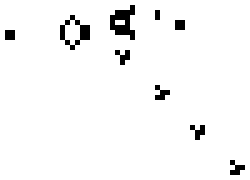

+++
title = "unasanu — вселенная как число"
date = 2023-08-28
description = "Философская концепция, которая объясняет, почему существует любая вселенная и что будет после смерти"

[taxonomies]
tags = []

[extra]
image = "thumbnail.png"
language = "Русский"
translation = "Original"
language_flag = "russian.png"
toc_text = "Содержание"
minutes_text = "мин"
author_name = "Шепрут Илья"
license_word = "Лицензия"
date_text = "28 августа 2023"
lang = "ru"
position = 1
+++

# Введение

{{ admonition_start(color="blue", title="📝 Вводимое определение") }}
**Unasanu** (= **un**iverse **as** **a** **nu**mber, унасану, вселенная как число) — философская концепция, согласно которой любая симулируемая вселенная существует, потому что её можно представить уже существующим натуральным числом. Из этой концепции можно вывести объяснения для следующих вопросов:
* Существуют ли альтернативные вселенные и почему?
* Живём ли мы в симуляции?
* Может ли теоретически существовать бог и насколько он может быть всемогущ?
* Почему невозможно умереть и что будет после смерти?
* Возможно ли сменить вселенную, не беспокоясь о тепловой смерти?
{{ admonition_end() }}

Эта идея и её следствия логически выводятся из современного понимания математики, физики и сознания. Однако unasanu не требует многомировой интерпретации квантовой механики, бесконечности нашей вселенной или гипотезы об Омега-точке, она опирается на другие, более надёжные и простые основания.

Статья описывает ту же самую идею, что и гипотеза математической Вселенной Макса Тегмарка [\[1\]] или теория пыли Грега Игана [\[2\]], но с большим количеством следствий и идей, которые данные авторы не рассматривали или рассматривали очень поверхностно.

Я пишу данную статью, чтобы:
* собрать воедино все философские следствия из этой идеи,
* эти идеи не переизобретались заново, 
* сформировать направление дальнейших исследований.

# Виды симуляций

Мы знакомы с идеей симуляции внешнего физического мира на компьютере. Эта тема активно обсуждается в поп-культуре и философии. Для начала нужно договориться о том, как мы называем разные категории симуляций. Мне кажется, что при обсуждении этой темы возникает множество недопониманий, потому что люди редко разделяют эти две категории.

## Иллюзорная

{{ admonition_start(color="blue", title="📝 Вводимое определение") }}
**Иллюзорная симуляция** — это такая симуляция, которая создаёт иллюзию реальности окружающего мира путём обмана наблюдателя. Другое название для таких симуляций — виртуальная реальность [\[3\]]. Примеры таких симуляций: фильм «Матрица» [\[4\]], игра The Sims [\[5\]] (мир иллюзорен для симов), фильм «Тринадцатый этаж» [\[6\]].
{{ admonition_end() }}

Иллюзорная симуляция аппроксимирует всё, что можно. Например, в ней человек может состоять не из биологических клеток или атомов, а из одного неделимого объекта или аппроксимации органов и конечностей. Это необходимо для экономии вычислительных ресурсов и ресурсов программистов. Ведь более требовательная симуляция просто не будет иметь смысла, потому что её нельзя будет запускать в реальном времени либо её нельзя будет запрограммировать за разумное время.

Людям не нравится идея жить в иллюзорной симуляции. Все хотят считать, что их реальность реальна и ничто их намеренно не обманывает и не упрощает. Не зря вся поп-культура о жизни в иллюзорной реальности строится на том, чтобы выбраться из неё.

## Физическая

{{ admonition_start(color="blue", title="📝 Вводимое определение") }}
**Физическая симуляция** — это такая симуляция, в которой делается исключительно симуляция физики на основе некоторой фундаментальной теории. То есть это симуляция с точностью до атомов/кварков/струн/???/пикселей/вершин графа. Примеры физических симуляций: теория всего, игра «Жизнь» Джона Конвея [\[7\]], проект физики Стивена Вольфрама [\[8\]].
{{ admonition_end() }}

Физическая симуляция симулирует низкоуровневые законы, она не аппроксимирует ничего. На основе этих низкоуровневых законов могут строиться высокоуровневые структуры (как, например, законы газов могут строиться на модели того, что газ состоит из упругих частиц). А то, какие структуры возникли и по каким высокоуровневым законам будут функционировать эти структуры, зависит от самих структур. В физической симуляции высокоуровневые структуры (например, человек) не аппроксимируются чем-то более простым: если в такой симуляции существует человек, то он существует с точностью до клеток и атомов.

Существует вероятность того, что наша реальность является физической симуляцией. Однако эта идея недоказуема и неопровержима. Если мы живём в физической симуляции, то нас это вполне устраивает, потому что сохраняется всё, что мы знаем про физику, эволюцию звёзд, эволюцию живых существ. Утверждение «из того, что мы живём в симуляции, следует, что всё это нереально» бессмысленно в случае физической симуляции, потому что такая симуляция и есть реальность. Единственное неприятное заключается в том, что кто-то внешний может иметь контроль над нашей физической реальностью, подобно «креативному режиму» в игре Minecraft [\[9\]]. Далее эта гипотетическая возможность будет рассмотрена.

Важно помнить, что **симуляция ≠ имитация**. Эти слова похожи, но имеют совершенно разный смысл. Мир вполне может быть очень реальным, если его законы физики симулируются на компьютере.

# Игра «Жизнь»

## Устройство

Игра «Жизнь» — на самом деле это не игра и не жизнь, а клеточный автомат. Мне необходимо рассказать об этом, потому что это самый наглядный пример физической симуляции, на основе которого можно строить много аналогий, необходимых в данной статье.

Этот автомат работает по следующим правилам:
* Имеется двумерное бесконечное (или конечное, замкнутое на себе) поле квадратных клеток.

{{ image(path="../img/game_of_life_infinite_grid.png", scale="2/3") }}

* Каждая клетка может быть пустой или закрашенной.
* В этом автомате существует течение времени, и оно обеспечивается вычислением следующего момента времени из предыдущего на основании некоторых правил.
* Есть некоторый начальный момент времени, и из него мы итеративно вычисляем будущие.

{{ image(path="../img/game_of_life_time.png") }}

* Соседями клетки считаются четыре прямых соседа и четыре соседа по диагонали.

{{ image_svg(path="game_of_life_neighbors.drawio.svg", scale="1/2") }}

* Вычисления состоят в изменении состояния клеток на основании их соседей по следующим правилам:
    * Если клетка была пустой, то она становится закрашенной тогда и только тогда, когда три её соседа на предыдущем шаге были закрашены, иначе она остаётся пустой.
    * Если клетка была закрашенной, то она остаётся такой тогда и только тогда, когда два или три её соседа на предыдущем шаге были закрашены, иначе она становится пустой.
* Эти правила обозначаются как B3/S23 (Born 3 / Survive 2 or 3).

{{ image_svg(path="game_of_life_rules.drawio.svg", scale="2/3") }}

На следующей интерактивной визуализации можно увидеть, как развивается этот клеточный автомат для случайного распределения закрашенных и пустых клеток:

{{ game_of_life(
    start_stop="Старт/Стоп",
    step="Шаг",
    empty="Пустота",
    random="Случайное",
    glider="Глайдер"
) }}

Можно самому поиграть в более продвинутых симуляторах, например на `conwaylife.com` [\[10\]].

## Впечатляющие возможности

В этом автомате можно построить огромное число механизмов. Вот некоторые из них.

Первый пример — глайдер из визуализации выше. Этот механизм передвигается по диагонали. Можно сказать, что это аналог фотона. 

Также можно сделать генератор таких глайдеров:

{{ figure_start() }}

{{ figure_end(caption="Глайдерное ружьё Госпера.") }}

---

Клеточный автомат «Игра "Жизнь"» является тьюринг-полным, то есть на нём можно построить компьютер или машину Тьюринга. Вот её пример (источник с интерактивной симуляцией [\[11\]]):

{{ image(path="../img/game_of_life_turing_machine.png", scale="2/3") }}

---

В интерактивной визуализации `oimo.io/works/life` [\[12\]] (работает и с телефона) игра «Жизнь» симулируется на самой себе как вглубь, бесконечно малое, так и ввысь, бесконечно большое:

{{ image(path="../img/game_of_life_on_itself.png", scale="2/3") }}

---

Джон фон Нейман придумал клеточный автомат и механизм в нём, который может самовоспроизводиться. На изображении ниже показано, как второй автомат практически закончил строить третий; линии, идущие направо, являются генетической информацией, которая копируется вместе с телом машин. 

{{ image(path="../img/von_neumann.png", scale="2/3") }}

---

Тим Хаттон [\[13\]] разработал искусственную химию, в которой он спроектировал такие элементы и такие взаимодействия между ними, чтобы собрать искусственную клетку, способную размножаться:

{{ video(path="../img/chemistry.mp4", scale="2/3") }}

Это не клеточный автомат, но очень легко встаёт на его рельсы, и автор продолжает развивать эту идею в виде клеточного автомата [\[14\]]:

{{ image(path="../img/chemistry_automata.png", scale="2/3") }}

---

Я показал вам всё это, чтобы убедить, что клеточные автоматы — это не просто игрушки, а серьёзные концепции, которые достойны быть аналогией к фундаментальной физике.

## Аналогия с физикой

{{ admonition_start(color="gray", title="💬 Цитата из статьи Cellular automata with 2 temporal dimensions [\[15\]](http://dmishin.blogspot.com/2014/06/cellular-automata-with-2-temporal.html)") }}
Клеточные автоматы — отличные примеры «игрушечной физики», которую мы понимаем снизу вверх. В реальном мире мы наблюдаем сложные феномены и можем только догадываться о низлежащих принципах (этим занимаются физики). В мире клеточных автоматов ровно наоборот: известны низлежащие принципы, а поведение сложных систем является объектом исследований.
{{ admonition_end() }}

У автомата «Игра "Жизнь"» есть множество интересных свойств:
* Законы физики и материя отделены друг от друга.
* Материю можно редактировать как угодно: рисовать, копировать, вставлять, удалять.
* Над любой изменённой материей можно запустить симуляцию.
* Существует некоторый начальный момент времени.
* Время является вычислением законов физики, и в качестве момента времени есть дискретный срез состояния поля.
* Законы физики являются локальными, то есть они работают только над некоторой областью пространства, нет дальнодействия, и благодаря этому естественным образом возникает максимальная допустимая скорость — аналог скорости света в нашем мире.

Но в этом автомате есть также отличия от нашей физики:
* Нет никаких законов сохранения (например, числа клеток), но для их любителей можно найти клеточные автоматы с законами сохранения.
* Время возможно симулировать только вперёд (назад нельзя), потому что прошлых моментов времени может быть от 0 до бесконечности. Это не обязательно свойство нашей физики, наша физика может быть обратимой (и обратимые автоматы тоже существуют — я исследовал их на примере Critters в [своей статье об обратимых клеточных автоматах](https://optozorax.github.io/p/critters/)).

Далее будет предполагаться, что наша физика в самом своём основании _является чем-то типа клеточного автомата_ (с большими допущениями, но в свою защиту эту тему раскрою далее). То есть к ней применимы описанные выше свойства.

А даже если наша физика не похожа на клеточный автомат, то это является хорошей отправной точкой, потому что понимать, как именно она отличается, — тоже хорошо.

# Мысленный эксперимент с физической симуляцией

## Описание эксперимента

Предположим, что наступит очень далёкое будущее, в котором мы смогли стать цивилизацией, использующей всю энергию Галактики, и построили компьютер размером с Солнечную систему, максимально эффективно использующий каждую планковскую длину.

Далее мы разработали правила некоторой простой физической симуляции, которая создана по образу и подобию нашей физики, но не повторяет её точь-в-точь. Необходимо это, потому что наша физика очень избыточна и странна со всей этой квантовой механикой и теорией относительности. Разработали мы эту физику таким образом, чтобы её химия могла быть достаточно богатой, чтобы на ней потенциально могла существовать и самозародиться жизнь.

Так как мы захотим запускать эту симуляцию на компьютере, у нас появляются некоторые ограничения. Наша симуляция должна быть:
* дискретной,
* конечной,
* детерминированной,
* останавливающейся (для каждого шага).

Ещё я хочу наложить ограничение, что в симуляции мы имеем право вмешиваться только в начальные условия и больше никогда.

Прежде чем перейдём к сути эксперимента, давайте проясним каждый термин.

## Дискретная физика

Известны два вида пространств: континуум и дискретное пространство.

{{ container_start() }}
{{ figure_start() }}
{{ image(path="../img/continuous2.png", scale="2/3") }}
{{ figure_end(caption="Пример континуума") }}
{{ figure_start() }}
{{ image(path="../img/discrete2.png", scale="2/3") }}
{{ figure_end(caption="Пример дискретного пространства") }}
{{ container_end() }}

<!-- https://www.desmos.com/calculator/iuoa2bl8uc -->

Дискретное пространство конечной длины можно разделить на конечное число элементарных элементов. Континуум конечной длины содержит так же много чисел, как и отрезок (-∞; +∞), то есть он бесконечно делим, при этом каждое число имеет бесконечное число знаков после запятой.

Очевидно, невозможно засунуть континуум непосредственно в компьютер. Поэтому все наши симуляции оперируют конечным числом дискретных объектов. Когда мы симулируем физику, то мы используем дискретные аппроксимации.

Правда, между дискретностью и континуальностью существует интересная связь. Например, законы о работе волн (колебания, период) построены на идее о том, что материал, в котором эти волны распространяются, состоит из континуума. Но мы-то знаем, что все жидкости, газы и твёрдые материалы состоят из дискретных атомов, просто очень большого их количества. Поэтому некоторые континуальные физические законы, хоть и красивы, на самом деле являются лишь аппроксимацией того, что работает на дискретном основании.

Аналогично можно предположить, что и квантовая механика работает подобным образом, но это лишь предположение, и оно не обязательно верно. Мы же в мысленном эксперименте хотим иметь такую физику, которая является дискретной в самом своём основании, при этом не ломая возможность того, чтобы на больших масштабах она могла казаться континуальной.

## Конечная физика

Здесь всё просто — пространство нашей симуляции должно быть конечно, потому что мы не можем оперировать бесконечным числом объектов. Для нашего эксперимента можно просто взять большое расстояние, и этого будет достаточно.

## Детерминированная физика

{{ admonition_start(color="blue2", title="📖 Определение") }}
**Детерминированность** — свойство процессов, которое означает, что процесс всегда будет выдавать один-единственный результат для данных начальных условий, сколько его ни запускай.
{{ admonition_end() }}

Детерминированность означает, что будущее симуляции однозначно определено и там не присутствует какой-то фундаментальной случайности. Это логичное требование, потому что компьютеры умеют делать только детерминированные вычисления и не умеют в абсолютную случайность.

{{ admonition_start(color="red2", title="⚠️ Примечание") }}
Некоторые могут сказать, что гонки данных, неинициализированная память и космические лучи могут являться источником абсолютной случайности. Давайте договоримся, что весь код в мысленном эксперименте исполняется на однопоточной виртуальной машине в идеальной среде и вся новая выделенная память для неё предварительно занулена. Поэтому мы будем рассуждать только о детерминированных симуляциях.
{{ admonition_end() }}

Процессы в нашем мире выглядят детерминированно, хотя нам и очень тяжело предсказывать некоторые события. Также детерминированные процессы могут обладать хаосом. Так что детерминированный мир снова может быть похож на наш, и это требование особо не умаляет нашу физическую симуляцию.

Про симуляцию абсолютно случайных процессов также будет сказано в следующих главах.

## Останавливающаяся физика

Это ни в коем случае не значит, что должен существовать шаг, после которого симуляция должна остановиться (например, тепловая смерть), а значит, что каждый шаг симуляции должен выполняться за конечное и предсказуемое число шагов. Это значит, что внутри вычисления одного шага симуляции не должно возникать вечных циклов и всего подобного. Это требование необходимо, потому что нам нет смысла запускать симуляцию, которая может на каком-то интересном месте уйти в бесконечный цикл и потом не выдавать никаких результатов.

Ну и ещё это требование необходимо, потому что мы не хотим решать проблему останова [\[16\]] (хорошее видео на эту тему [\[17\]]), которую в общем случае разрешить невозможно.

## Запуск симуляции

Кажется, что создание такой физики не должно быть невозможным. Поэтому в мысленном эксперименте мы нашли подходящего кандидата. Хотя вы вольны не согласиться с тем, что создание такой физики возможно.

Далее мы запускаем эту физику над некоторым конечным пространством на нашем суперкомпьютере и ждём, пока там не самозародится жизнь. Если она не зарождается, то можно немного поиграть с начальными условиями, подобрать оптимальное количество нужных атомов или разместить газопылевое облако на нужном расстоянии от своей звезды, чтобы оно находилось в обитаемой зоне и т.6 д.

Предположим, мы смогли найти такие начальные условия, при которых возникает жизнь, и затем мы очень долго симулируем и ждём, пока она доэволюционирует до разумных существ, способных общаться друг с другом с помощью какого-то языка.

Наверняка у этих существ есть что-то типа инстинкта самосохранения, сексуального влечения, удовольствия от еды и страданий от повреждения тела. Потому что это логичный путь эволюции для индивидуальных существ с мозгом. Существа без этого, скорее всего, будут менее эффективны в выживании и отсеются эволюцией.

{{ admonition_start(color="gray", title="❓ Вопрос к читателю") }}
Пожалуйста, остановитесь и ответьте на следующие вопросы. Желательно, чтобы вы ещё и объяснили свои ответы.

Как вы считаете, данные существа чувствуют, что они живут? Они наблюдают свой мир? У них есть субъективные переживания, aka квалиа? Они живые?

Если вы не считаете, что они что-то чувствуют, то предложите, какими свойствами должна обладать симуляция, чтобы вы посчитали их чувствующими.
{{ admonition_end() }}

От ответа на этот вопрос зависит, как вы будете воспринимать дальнейшее повествование.

Я так подробно описывал эту симуляцию, чтобы приблизить ваше видение этих существ максимально близко к людям, но при этом чтобы не пользоваться непосредственно нашим миром, потому что неизвестно, насколько удачно мы можем его симулировать. И главная суть в том, что всё описанное выглядит вполне гипотетически возможным. Потому что пока мы не обнаружили каких-то фундаментальных законов, которые бы запрещали существам в физической симуляции обладать разумом или чувствами.

Я надеюсь, вы ответили положительно на вопрос о том, что эти существа что-то чувствуют. Аргумент «они не чувствуют ничего просто потому, что я знаю, что они находятся в компьютере» слишком ленив. Нужно пытаться это опровергнуть более умно.

Если же вы не согласны, то не страшно. Далее я рассмотрю и такую точку зрения.

Предположим, вы согласились, что эти существа живые, что они чувствуют, что живут, могут общаться на эту тему и задаваться вопросом о боге или вопросом, живут ли они в симуляции. Мы никак не воздействуем на их мир, так что они никак не могут понять, что мы из себя представляем, и у них нет поводов сомневаться в реальности и честности своего физического мира.

{{ admonition_start(color="green2", title="🤔 Проверяемое утверждение") }}
Возможно ли самозарождение жизни в симуляции?
{{ admonition_end() }}

## Что, если мы остановим симуляцию?

{{ admonition_start(color="gray", title="❓ Вопрос к читателю") }}
Как вы считаете, что произойдёт, если мы остановим симуляцию? Умрут ли существа внутри неё? Или не умрут, а перестанут чувствовать свою жизнь? Или каким-то чудесным образом продолжат жить?
{{ admonition_end() }}

Конечно, вы скажете, что они умрут, потому что а как иначе? Когда мы их симулируем — они живут, когда мы их выключаем — они не живут. Всё просто. Но нет. Я утверждаю, что после выключения симуляции эти существа продолжат жить. 

Как я уже сказал, у нашей симуляции есть некоторые фундаментальные ограничения, без которых мы не можем запустить её на компьютере, а именно — это **детерминированность**. Детерминированность означает, что существует лишь единственный исход для данной программы, если заданы начальные условия и далее не было никакого вмешательства в программу. А теперь такой вопрос: если будущее единственное, зачем нам его симулировать? Что меняется от факта нашей симуляции? Мы никак не можем повлиять на будущее, оно в любом случае будет таким, каким будет.

Если этого недостаточно, чтобы осознать силу детерминированности, вот ещё парочка мысленных экспериментов:
* Если мы удалим весь результат симуляции и просимулируем снова с самого начала, то получим абсолютно такой же результат.
* Если мы поставим симуляцию на паузу и продолжим через миллиард лет, то существа внутри никак это не почувствуют. Течение времени для них будет продиктовано внутренними законами их вселенной. Мы существуем вне их времени, а они — вне нашего времени.
* Если мы запустим эту же симуляцию одновременно на нескольких компьютерах, то для существ ничего не поменяется.
* Если симуляция обратима и мы каким-то образом достали очень далёкий момент из будущего, то от того, что будем симулировать его в обратную сторону, существа не будут чувствовать, что живут в обратную сторону.

Конечно, этого тоже может быть недостаточно, и далее я покажу, как можно доказать, что они будут живы даже с требованием симулировать их мир.

# Вселенная как число

Ладно, мы согласились, что существа живы, когда мы их симулируем на компьютере, и нам недостаточно того, что у них единственное будущее. Мы считаем, что их будущее существует только после того, как мы его просимулировали.

Тогда давайте точно специфицируем, что у нас есть, чтобы сказать, что это является доказательством того, что они жили данный промежуток времени. Всё, что у нас есть, — это алгоритм симуляции и все шаги симуляции вплоть до текущего. Мы считаем, что факт существования этой информации эквивалентен доказательству жизни этих существ.

Предположим, мы сделали эту симуляцию, получили все данные и записали их на большой жёсткий диск: сначала алгоритм, затем шаг 1, затем шаг 2, ..., шаг N. Всё, теперь у нас есть доказательство того, что они жили до шага N. Но ведь данные на жёстком диске — это всегда какая-то последовательность нулей и единиц. Мы можем взять и записать данные с жёсткого диска в виде одного очень большого натурального числа. И это натуральное число всё ещё является доказательством жизни данных существ.

{{ image_svg(path="number.drawio.svg", scale="2/3") }}

Теперь интересный момент: как мы знаем, все натуральные числа существуют.

Раз все натуральные числа существуют, то среди них обязательно найдётся число, которым мы закодировали симуляцию существ просимулированных нами. Но среди них также существует эта же симуляция, но с моментом времени +1. А также среди них существует любая другая симуляция, для любого момента времени внутри этой симуляции. И все эти числа эквивалентны доказательству жизни каких-то существ, которые эти симуляции содержат.

Из чего мы заключаем, что результат любой симуляции, которую можно запустить на компьютере, уже существует в виде натурального числа. Именно отсюда и возникает название данной концепции: **вселенная как число**.

{{ admonition_start(color="blue", title="📝 Вводимое определение") }}
**Существование для самого себя** — некоторая вселенная существует сама для себя, если живые существа внутри неё способны наблюдать собственное существование и свою вселенную.
{{ admonition_end() }}

Ранее мы договорились, что существа в симуляции на компьютере способны наблюдать собственную вселенную. Значит, эта вселенная как минимум существует сама для себя. А затем мы пришли к тому, что это существование равноценно существованию в виде числа. Поэтому из существования всех натуральных чисел следует существование всех возможных симулированных вселенных самих для себя. А значит, во всех таких вселенных, где есть жизнь, эта жизнь будет наблюдать свою вселенную.

Этот пример с физической симуляцией мне нравится тем, что для него мы не должны давать определение сущестования, а что он настолько самоочевидный, что мы должны выводить определение существования из него. И в данном случае мы выводим определение «существование для самого себя». Если мы согласны, что они чувствуют свою жизнь внутри симуляции, когда мы запускаем её на компьютере, то из этого мы должны немедленно заключить, что они чувствовали жизнь и без нашей симуляции, существуя в виде числа.

Что же тогда происходит, когда мы симулируем некоторый мир? В этом плане можно сказать, что симуляцией мы не создаём мир, а наблюдаем уже существующий. И вычислительные мощности тратятся именно на наблюдение. А подбор начальных условий — это не «создание мира», а поиск мира с нужными нам свойствами среди бесконечного множества самых разнообразных миров.

А когда мы останавливаем симуляцию, то существа продолжают жить сами для себя. Они могут сказать об этом другим существам в их вселенной, но не нам. Мы не можем этого наблюдать, потому что выключили симуляцию.

## Антропный принцип

{{ admonition_start(color="blue2", title="📖 Определение") }}
**Антропный принцип** — принцип, согласно которому вселенная является такой идеально подстроенной под возникновение жизни и человека в качестве наблюдателя именно потому, что в других вселенных, которые так не подстроены, наблюдатель невозможен.
{{ admonition_end() }}

Unasanu отлично согласуется с антропным принципом. Для себя я его формулирую так: если существуют все возможные вселенные, то наблюдатели возникают только в тех вселенных, где возможно их возникновение.

Антропный принцип необходим, потому что физики наблюдают, что самые фундаментальные константы подогнаны идеально под наше существование. Будь некоторые из них на процент меньше или больше, жизнь в том виде, в каком мы её наблюдаем, была бы невозможна. Более подробно об этом можно почитать в книге «Наша математическая вселенная» [\[18\]].

## Аргумент неправильных вычислений

Можно возразить: откуда же берутся вычисления, если у нас существуют просто числа? Я ведь могу взять любую правильно вычисленную вселенную и записать её неправильно, и это тоже будет существовать в виде числа. Почему тогда вычисления обязаны существовать?

### Вычисление всеми законами физики

Есть и другой похожий момент. Если вселенная может вычисляться текущими законами физики, то почему она не вычисляется другими законами физики? На самом деле вычисляется, и согласно unasanu такие миры существуют. Возьмём в качестве примера аналогию с игрой «Жизнь». На следующей иллюстрации показывается, как одно и то же поле вычисляется разными правилами:

{{ game_of_life_all_rules(
    start_stop="Старт/Стоп",
    step="Шаг",
    random_rules="Случайные правила",
    copy_from_original="Скопировать с B3/S23",
    random="Случайное поле",
    glider="Глайдер",
    glider_gun="Глайдерное ружьё"
) }}

Попробуйте нажать «Старт» и раз в секунду нажимать кнопку «Скопировать с B3/S23». Вы увидите, что любое состояние из B3/S23 может вычисляться любыми другими правилами, и это существует в рамках unasanu.

И это я приложил только самую малую часть (то, что поддаётся нотации `B/S`), а на самом деле существует бесконечное число способов вычислять следующий шаг такого поля с клетками, имеющими два состояния.

Очевидно, это поле можно взять в качестве основы для вычисления всеми возможными правилами. И так с каждым моментом времени и каждым правилом, которые только можно сконструировать.

Абсолютно аналогично ничего не мешает взять все возможные модификации данного поля и вычислять их оригинальным правилом.

Всё это существует согласно unasanu, и у этого есть много последствий, которые будут обсуждены далее.

Так почему мы не наблюдаем вычисление нашей вселенной произвольными законами физики и вообще наблюдаем какое-то вычисление?

### Антропная фильтрация

Это можно объяснить тем, что именно наблюдатель держит законы вселенной в стабильности, обеспечивая существование вычислений и конкретных законов физики для себя. Как?

Для начала рассмотрим аргумент неправильных вычислений. Если вселенная не вычисляется ни по каким законам, то в ней и невозможны наблюдатели, которые бы наблюдали эту вселенную. Потому что факт наблюдения — это вычисление. А если вселенная подчиняется законам, то в ней возможен наблюдатель. Поэтому наблюдатель может наблюдать только вычисляемую вселенную.

И теперь аргумент про все возможные законы физики, их тоже держит в стабильности наблюдатель. Точнее, он наблюдает только стабильные законы физики. Потому что при вычислении атомов мозга какими-то другими законами физики мозг может перестать работать, и наблюдатель не будет ничего наблюдать в такой вселенной.

В каком-то смысле это похоже на антропный принцип, только более фундаментальный и происходящий в каждый момент времени, а не только при старте времён в момент создания вселенной. Предлагаю ввести термин для этого.

{{ admonition_start(color="blue", title="📝 Вводимое определение") }}
**Антропная фильтрация** — принцип, согласно которому наблюдатель способен фильтровать вселенные, в которых не совершаются вычисления или они совершаются неправильно, а также способен фильтровать вселенные, где его возникновение или существование невозможно.
{{ admonition_end() }}

Далее мы увидим, что к некоторым подобным аргументам антропная фильтрация применима, а к другим нет.

### Ложный вакуум

В физике есть состояние вещества под названием «ложный вакуум». Его возникновение вероятно. Если оно возникает в одной точке вселенной, то оно распространяется во все стороны со скоростью света, уничтожая всё, что в него попадёт. Ни один человек не способен наблюдать существование ложного вакуума, потому что его мозг работает слишком медленно и он просто умрёт, прежде чем осознает это, а информация о ложном вакууме не может обогнать скорость света.

Таким образом, ложный вакуум относится к примерам антропной фильтрации. Потому что для тех вселенных, где он возник, все живые существа умерли и не узнали об этом, а другие вселенные, которые отличаются на один атом, где этот ложный вакуум не возник, продолжают существовать. Таким образом, ложный вакуум поддаётся антропной фильтрации.

И если законы физики фильтруются наблюдателем единожды, при возникновении вселенной или рождении наблюдателя в нужной вселенной, то ложный вакуум фильтруется наблюдателями в каждый момент времени. И если учёные выяснят, что вероятность возникновения ложного вакуума в наблюдаемой вселенной очень высока, но он никогда не возникает и мы продолжаем жить, то в этом нет никаких противоречий с точки зрения unasanu.

Кстати, может быть очень весело, когда мы создадим теорию всего и вдруг окажется, что любая симуляция на её основе через какое-то время будет уничтожаться от ложного вакуума. :)

{{ admonition_start(color="violet", title="🔮 Предсказание") }}
Если мы сможем создать теорию всего и согласно ей мы должны были бы давно умереть от ложного вакуума или подобных явлений мгновенной смерти всего сущего, то это не означает, что данная теория неверна.
{{ admonition_end() }}

## Этернализм

У некоторых из читателей может возникнуть вопрос: «А как же время?» Ранее я неявно предполагал, что вселенные вместе со своим временем существуют в виде статичного куска данных, полностью игнорируя ту динамику, которую мы ощущаем за счёт течения времени. Эта точка зрения называется этернализмом.

{{ admonition_start(color="blue2", title="📖 Определение") }}
**Этернализм** — точка зрения на время, согласно которой будущие события уже существуют, объективного «течения» времени не существует и всё пространство-время может быть представлено как статичный неизменяемый «блок» [\[19\]].
{{ admonition_end() }}

Я утверждаю, что этернализм — это правильное толкование времени для симуляций. В следующих главах я свожу нашу вселенную к классу симулируемых на компьютере, поэтому этернализм должен быть применим и к нашему времени. Давайте разбираться в этернализме для симуляций, раз он является важной частью unasanu.

Как работает время у людей? У нас в данный момент времени имеются только воспоминания о прошлом и ощущение настоящего. Мы не можем напрямую ощутить прошлое или будущее. Мы можем понять, каким могло быть прошлое, по некоторым физическим объектам, например кинозаписям, археологическим артефактам и собственным воспоминаниям. Нам приходится всему этому доверять. Также мы можем общаться только с людьми из нашего времени, потому что таковы законы физики. Из того, что существуют люди в будущем, не следует, что у нас должна быть возможность с ними взаимодействовать, кроме как дожить до этого времени.

Почему мы ощущаем, как время идёт постепенно, а не ощущаем сразу случайный будущий момент времени, если он уже существует? Потому что из законов физики и конструкции нашего мозга следует, что, чтобы мозг 20-летнего человека что-то почувствовал, он должен сначала прожить все эти 20 лет и запомнить их. Так что наверняка вы и являетесь сейчас мозгом из случайного будущего (вероятно, перед самым моментом вашей смерти), просто он помнит, как прожил все прошлые моменты времени, и вам кажется, что вы живёте сейчас.

Как работает время в симуляции? В дискретных симуляциях будущее состояние атомарно вычисляется из прошлого состояния. Внутри симуляции невозможно почувствовать время «между шагами симуляции», потому что сами внутренние законы симуляции способны оперировать только над завершённым вычислением состояния. То есть для симуляции не существует никакой фундаментальной динамики, существуют только разные статичные моменты времени, которые связаны логическими отношениями, и наблюдатель интерпретирует их как динамически сменяющиеся.

Как вариант «опровержения» этернализма для симуляций можно предположить следующее: берём за аксиому, что в нашем мире время несводимо к статичным структурам. Тогда если мы полагаем, что в некоторой симуляции существует время, подобное нашему, то единственный способ, как его можно определить, — это привязать к нашему времени. Тогда время в симуляции течёт вместе с нашим временем, пока мы его вычисляем.

Это можно опровергнуть двумя способами, показав, что «текущий» момент времени в симуляции не является единственным:
* Создадим копию этой симуляции и будем её симулировать с секундным опаздыванием. Тогда какое время является «текущим»? Какое время ощущают существа внутри симуляции в «данный момент времени»?
* Существуют такие классы симуляций, как «обратимые». Их можно симулировать не только в будущее, но и в прошлое. Кстати, квантовая механика является обратимой, так что такая симуляция может быть очень даже похожа на нашу вселенную. Так вот, что, если мы создадим копию этой симуляции и начнём одновременно симулировать её и в прошлое, и в будущее? Какой момент времени будет являться текущим?

Итак, мы не можем никак опровергнуть идею о том, что для компьютерной симуляции время не может существовать в виде статичной структуры. Можно даже сказать по-другому: симуляция не может описываться чем-то динамическим, только статическими блоками. И в этом не наблюдается никаких парадоксов, даже если применить к нашей вселенной. Таким образом, главное свойство времени — это не постоянное движение, а то, что оно связывает разные (временные) слои информации некоторыми законами физики.

Ещё можно сказать, что время существует не как какая-то глобальная структура, и все симуляции подчиняются ему, а, наоборот, время существует внутри симуляций.

А ещё этернализм — это непроверяемое и неопровержимое утверждение, потому что это просто интерпретация времени детерминированных вселенных.

Также может показаться, что этернализм предполагает абсолютный детерминизм и требует, чтобы будущее было единственно. Но этернализм вполне совместим и с вселенными со множеством будущих, и с абсолютной случайностью, далее это будет показано. Нужно просто представлять итоговый блок «пространства-времени» не как статичную колбасу, а как статичное дерево. :)

## Взаимодействие с симуляцией

Начиная с этого момента ограничения, наложенные ранее, будут постепенно ослабевать.

Я говорил, что для мысленного эксперимента предлагаю не вмешиваться в симуляцию. Что будет, если мы отменим это ограничение? Симуляция станет недетерминированной? Нет.

Предположим, мы дошли до шага N в симуляции и в редакторе атомов захотели удалить тоталитарных правителей, развязывающих войны. После этого существа внутри недоумевают, но ликуют. Но что такое вмешательство в симуляцию? Это некоторая последовательность действий, которая отправляется программе симуляции. А значит, и эту последовательность действий можно закодировать числом.

Если мы запишем все наши вмешательства и потом допишем их рядом с программой и скажем, чтобы они отправлялись в нужное время симуляции, то мы снова можем получить абсолютно детерминированную симуляцию. Которую можно будет запускать снова и снова, и она будет давать один и тот же результат, хоть её результат мы и будем интерпретировать как такой, в который вмешались.

И все такие возможные вмешательства тоже можно закодировать числом и дописать рядом с числом обычной программы симуляции. Поэтому все возможные вселенные со всеми возможными вмешательствами также существуют, даже без необходимости в них вмешиваться непосредственно.

При этом нельзя забывать, что как существуют вселенные со всеми возможными вмешательствами, так и продолжает существовать вселенная без каких-либо вмешательств.

## Математические структуры Тегмарка

Ранее я подразумевал, что симуляция имеет следующую структуру:
* Имеется какое-то начальное состояние `O` данной симуляции.
* Имеется некоторая функция/программа вычисления одного шага `F`, которая для каждого состояния данной симуляции возвращает следующее состояние данной симуляции, и ответ существует всегда.
* Суть симуляции заключается в совершении следующего алгоритма:
  * T = F(O)
  * T = F(T)
  * T = F(T)
  * ...

Таким образом, внутри симуляции «течет время», потому что мы приравниваем один шаг времени вычислений к шагу времени внутри симуляции. И во всей вселенной время существует глобально.

Но на самом деле такая интерпретация времени **наивна** и не позволяет существования гораздо более сложных вселенных, например:
* вселенных с многомерным временем (хорошая статья на эту тему [\[15\]]),
* нашей вселенной с теорией относительности,
* вселенных с путешествиями во времени.

{{ admonition_start(color="blue", title="📝 Вводимое определение") }}
**Наивная модель времени** — такая модель времени, в которой время дискретно и существует глобально во всей вселенной и следующий шаг всегда можно вычислить из предыдущего.
{{ admonition_end() }}

Поэтому на сцену выходит **гипотеза математической вселенной** [\[1\]] Макса Тегмарка, где он более фундаментально подошёл к этому вопросу, утверждая, что в физическом смысле существует любая вселенная, описываемая математической структурой.

{{ admonition_start(color="blue2", title="📖 Определение") }}
**Математическая структура** — набор абстрактных сущностей с отношениями между ними.
{{ admonition_end() }}

Точно известно, что все наивные симуляции являются подмножеством математических структур, так как результат работы программы задаёт абстрактную сущность, а сама программа определяет отношение между этими сущностями. Также точно известно, что во множество математических структур входят вселенные, для которых с помощью вычислений можно убедиться, что их участки пространства-времени удовлетворяют собственным законам. Поэтому в такой концепции вычисления нужны не для того, чтобы наблюдать мир (вычислять его шаги), а для того, чтобы проверить, что какой-то мир удовлетворяет собственным законам, либо чтобы его специфицировать.

{{ image_svg(path="structure.drawio.svg", scale="2/3") }}

Наверное, такое описание не очень понятно, поэтому я хочу показать пример вселенной, которая выглядит, что вычисляется наивно, но на самом деле таковой не является. Явный пример: путешествия во времени с невозможностью поменять прошлое. Мне известно два хороших таких примера: книги про Гарри Поттера и фильм «Довод». Представьте, как бы вы симулировали мир, где возможно путешествие во времени, но оно сделано так, что прошлое остаётся неизменным? Вам надо симулировать прошлое с учётом будущего, а будущее — с учётом прошлого, и они должны подходить друг другу. У нас пока нет способов вычислять вселенные с подобными законами путешествия во времени, поэтому тут единственный возможный вариант — это перебирать все возможные миры (со всеми возможными будущими и прошлыми) и проверять, какие из них удовлетворяют нужным законам. То есть весь мир можно вычислить только в формате «всё время сразу». Но существа в таком мире очевидно чувствуют, что они живут, и поражаются своим законам путешествия во времени. Более подробно об этом можно почитать в статье «Causal universes» [\[20\]].

Свой эксперимент с двумя направлениями времени я описал в [статье о клеточном автомате по мотивам «Довода»](https://optozorax.github.io/p/the-tenet-of-life/).

Кстати, есть статья под названием «The Universe is not a Computer» [\[21\]], которая предлагает по-другому взглянуть на способ описания физики и предлагает подход для вычисления «всё время сразу».

Другой пример ненаивной вселенной — наша вселенная с теорией относительности. У нас нет единого глобального времени. В каждом участке пространства время течёт с разной скоростью. Поэтому вся вселенная должна быть представлена как пространственно-временной блок, где время является лишь отношением между частями этого блока.

В обоих этих примерах вселенные могут быть аппроксимированы локальной наивностью. Для первой вселенной мы пренебрегаем путешествием во времени, а для второй мы пренебрегаем замедлением времени. Из-за этого я и далее продолжу рассуждать в терминах наивных симуляций, потому что так проще и это хорошо аппроксимирует множество возможных видов таких вселенных, если не все их. Но это может быть и ошибкой.

{{ admonition_start(color="green2", title="🤔 Проверяемое утверждение") }}
Сводятся ли наши законы физики к локальной наивности?
{{ admonition_end() }}

{{ admonition_start(color="red3", title="🤕 Слабое место") }}
Что, если нашу вселенную нельзя вычислять наивно и нельзя аппроксимировать наивными вычислениями даже локально? От этого будет зависеть много выводов этой статьи.
{{ admonition_end() }}

{{ admonition_start(color="orange", title="🔢 Математическая проблема") }}
Разработать формат описания вычислимых вселенных как «математических структур». Определить, возможно ли записать нашу вселенную в таком формате.
{{ admonition_end() }}

## Принцип конструирования

Если все возможные вселенные существуют, то существует ли вселенная Властелина колец, Звёздных войн, вселенные попаданцев из аниме? Чтобы ответить на эти вопросы, я ввожу следующий принцип.

{{ admonition_start(color="blue", title="📝 Вводимое определение") }}
**Принцип конструирования** — если предложить способ конструирования вселенной и её законы физики, то такая вселенная существует.
{{ admonition_end() }}

Например, если у нас есть программа симуляции нашей вселенной, то (по идее) мы можем взять её и сконструировать мир, где половина людей из текущего момента времени заменена на атомы воздуха. Поэтому такая вселенная существует физически, и кто-то чувствует, что живёт в этом абсурде.

Здесь «сконструировать» означает, что мы возьмём некоторую программу вида «Редактор атомов 11D Ultra», загрузим в неё наш текущий момент времени, отредактируем и получившийся набор атомов продолжим симулировать с отредактированного момента.

Можно ли аналогичным образом создать точную вселенную Властелина колец? С огромной вероятностью — **нет**. Для начала, законы физики для такой вселенной должны быть примерно такими же, как у нашей, с некоторыми модификациями ради наличия магии, но уже не факт, что такие законы физики можно найти. Далее, нам бы хотелось, чтобы такой мир возник самостоятельно, как наш, с Большим взрывом, эволюцией и т. д. Это ещё одно огромное ограничение, которое будет мешать нахождению такой вселенной. Потом нам хочется, чтобы в этой вселенной полностью повторился сюжет. Может быть, даже чтобы все живые существа выглядели как в фильме. В общем, все эти ограничения в итоге будут выглядеть как огромнейшая система уравнений на начальное состояние вселенной. А как мы знаем, не у всех систем уравнений есть решения. Просто потому, что, если построить их графики, они не будут пересекаться. Как на следующем примере:

{{ figure_start() }}
{{ image(path="../img/rings.png", scale="2/3") }}
{{ figure_end(caption="Два разных условия") }}

Здесь каждая точка — это вселенная, а график показывает вселенную, удовлетворяющую одному условию. Вселенная Властелина колец состоит из множества условий, поэтому эта вселенная должна являться пересечением всех графиков всех условий.

Но здесь есть точки, которые наиболее близки ко всем из этих условий:

{{ figure_start() }}
{{ image_svg(path="rings2.drawio.svg", scale="2/3") }}
{{ figure_end(caption="Вселенная, достаточно близкая ко всем условиям") }}

А это значит, что мы можем найти вселенные, которые приближённо удовлетворяют нашим условиям.

Поэтому вселенная Властелина колец вряд ли существует в абсолютно той точности, как она описана в книгах или показана в фильмах, со всеми нашими мыслимыми или немыслимыми требованиями к ней. Зато наверняка существуют близкие к ней вселенные, на которые наложено не так много ограничений, и чем больше компромиссов мы делаем, тем более естественным будет получаться результат, тем больше будет спектр таких вселенных. Может, даже то, что более естественная вселенная окажется куда интереснее вселенной Властелина колец, так что потеря невелика.

Зато ничто не мешает нам сконструировать вселенную попаданцев. Мы можем взять какой-то существующий в Средние века мир с людьми, затем вставить туда человека из будущего после смерти, симулировать такую вселенную дальше и смотреть, что произойдёт. Так что в этом плане вселенные попаданцев не являются невозможными. Хотя, опять же, абсолютно точный аналог из вашего любимого аниме вряд ли существует.

{{ admonition_start(color="red", title="⚠️ Примечание") }}
В этой главе я неявно предположил, что нашу вселенную можно симулировать на компьютере и что она подчиняется unasanu. Но это отдельный, большой вопрос, который мы обсудим далее. Пока что я буду такое неявно предполагать для простоты восприятия. Вы всегда можете экстраполировать эти примеры на другие вселенные, которые подчиняются unasunu.
{{ admonition_end() }}

А ещё принцип конструирования является самым главным кандидатом на опровержение, потому что нам ещё неизвестна теория всего, чтобы мы могли сказать, существует ли любая комбинация атомов или нет. Что, если мы не можем создать копию нашей вселенной, где половина людей заменена на воздух? Что, если это будет противоречить каким-то законам? Для простых наивных вселенных по типу игры «Жизнь» Конвея мы можем утверждать такое, но вряд ли это справедливо для всех типов вселенных.

Ну и конечно, принцип конструирования не может быть применён в некоторых случаях, если наша вселенная не вычисляется наивно.

Коротко можно сказать, что согласно unasanu существуют не все вообразимые миры, а все конструируемые.

## Субстрат-независимость

Если вам кажется удивительным то, что вселенные способны вычисляться на натуральных числах, то я хочу показать вам один принцип, который делает это более правдоподобным.

{{ admonition_start(color="blue2", title="📖 Определение") }}
**Субстрат-независимость** — это свойство вычислений, которое означает, что их результат не зависит от того, на чём эти вычисления производятся.
{{ admonition_end() }}

Независимо от того, как будут вычислять вселенную, в которой вы находитесь, вы этого не почувствуете. Поэтому не кажется удивительным возможность вычисления на статичных числах.

Мне кажется, что это одно из самых мощных свойств вычислений. Результат детерминированных вычислений не зависит от того, на каком тьюринг-полном субстрате мы их вычисляем:
* на компьютере, 
* на аналитической машине Бэббиджа,
* на живом компьютере из 30-миллионной армии людей (привет, Лю Цысинь!),
* на редстоуне из игры Minecraft,
* или если некоторое бессмертное существо производит эти вычисления на клеточном автомате 110, перекладывая камешки, согласно простейшим правилам (автомат 110 является тьюринг-полным [\[22\]]).

{{ details_start(summary="Да, я цитирую xkcd") }}
Картинка кликабельна.
{{ figure_start() }}
{{ image(path="505_v1.png", format="png", scale="1") }}
{{ figure_end(caption="xkcd/505 [\[23\]](https://xkcd.ru/505/)") }}
{{ details_end() }}

## Факт вычисления — это интерпретация наблюдателя

Предположим, что мы постулируем, что существуют только те вселенные, которые симулируются явно на наших компьютерах.

Предположим следующий мысленный эксперимент: мы запустили такую симуляцию, и там виртуальные существа живут своей жизнью, а затем человечество вымерло, и через миллиарды лет туда прилетели инопланетяне, чтобы посмотреть на то, что происходит. Что, если они не смогут до конца времён понять, что за вычисления производились на этом компьютере? Перестанет ли существовать виртуальная вселенная из-за этого? А что, если во вселенной существует огромное число компьютеров, которые производят все возможные симуляции, просто мы не нашли к ним нужную интерпретацию?

## Почему все натуральные числа существуют

Следующий аргумент, который можно привести против unasanu: почему все натуральные числа должны существовать сами по себе? Что, если симулируемая вселенная существует только потому, что число, её кодирующее, содержится на нашем компьютере?

Для начала, натуральные числа максимально естественны, самоочевидны и просты. Мне гораздо проще поверить в существование натуральных чисел самих по себе, чем в существование вещественных чисел с бесконечным числом знаков после запятой.

Но даже если этого недостаточно и если мы считаем, что существуют только те числа, которые кодируются некоторым физическим объектом, то даже в нашей конечной вселенной существует достаточно много чисел. Например, мы можем взять любой камень с улицы и послойно сканировать его, затем все изображения мы можем собрать в некоторое одно очень большое число. Каждый камень мы можем считывать под очень большим числом углов. Все его снимки мы можем перемешать в самом разном порядке, чтобы получить ещё большее количество чисел.

Ещё больше чисел получится, если мы будем рассматривать создание длинных чисел из соединения множества чисел из камней, считанных под разными углами. Мы можем брать невероятное число перестановок порядка камней и для каждого камня можем выбирать самый разный угол. Таким образом, в нашей вселенной наверняка можно найти все возможные числа до определённого размера.

Это означает, что в нашей вселенной закодировано достаточно много уже вычисленных вселенных. Даже можно сказать, что из факта существования нашей вселенной следует факт существования огромного числа других вселенных. Раньше я для себя доказывал существование других вселенных именно так и называл это «идеей о порождении миров», но теперь я нахожу натуральные числа более фундаментальными и не нуждаюсь в таких вещах.

Кстати, подобным образом формулируется и теория пыли Грега Игана [\[2\]], которую он описал в своём романе «Город Перестановок».

## Бесконечное время и бесконечная память

Можно показать, что для симуляций, существующих в виде чисел, доступна бесконечная память, бесконечное время и, соответственно, бесконечные вычислительные возможности.

Для начала, как достигается бесконечное время? Если мы в коде симуляции никак не ограничиваем существование следующего шага, то есть для любого текущего шага всегда существует следующий, то для любого числа, кодирующего шаги с 1 до N, всегда можно построить число, кодирующее шаги с 1 до N + 1. Следовательно, здесь время никак не ограничено, и вселенная в виде симуляции может существовать бесконечно.

{{ image_svg(path="next_step.drawio.svg", scale="2/3") }}

За счёт бесконечности времени можно сделать сколь угодно большую скорость вычислений, просто ставя сознание, наблюдающее вычисления, на паузу.

Про бесконечную память немного сложнее. Предположим, что под памятью мы понимаем длину числа, кодирующего текущий шаг. Например, у нас код написан таким образом, что алгоритм проверяет, относится ли предыдущий шаг к текущему. Тогда, когда мы запрашиваем память, мы находим следующее число, и алгоритм проверяет, является ли это число тем, что нам нужно. Когда памяти недостаточно, алгоритм может отвергнуть число, кодирующее эту симуляцию. Когда памяти сколько нужно, алгоритм принимает её. Тогда, сколько памяти мы бы ни запросили, всегда найдется число, в котором находится нужное количество памяти.

{{ image_svg(path="memory.drawio.svg", scale="2/3") }}

Поэтому правильнее будет сказать, что памяти можно запросить сколько угодно много, но каждый раз конечное число.

Бесконечность времени и памяти — это очень приятные свойства, которые далее будут активно использоваться.

# Применимо ли это к нашей вселенной

Ранее я не зря накладывал столько ограничений на симуляцию и в примере с мысленным экспериментом использовал альтернативную, вычислимую физику. Всё потому, что неизвестно, насколько наша вселенная способна существовать внутри компьютера, насколько она вычислима. Проблема не только в том, что мы не знаем теорию всего, чтобы ответить на этот вопрос, но и в том, что нам сейчас известны некоторые явления, которые вроде как опровергают эту возможность. Давайте рассмотрим известные проблемы.

{{ admonition_start(color="green2", title="🤔 Проверяемое утверждение") }}
Вычислимы ли наши законы физики?
{{ admonition_end() }}

## Симуляция бесконечной вселенной

Предположим, что наша вселенная бесконечна. Если это так, то ее невозможно вычислить на компьютере? Нет, так как у нас есть ограничение на максимальную скорость распространения информации — скорость света.

Давайте подумаем, какие вычисления нужно произвести, чтобы получить планету Земля на текущий момент времени? Надо взять какой-то конечный кусок пространства из Большого взрыва и симулировать его до текущего момента времени. При этом мы выбираем изначальный кусок настолько большим, чтобы отсутствие информации с краёв вселенной не успело долететь до Земли текущего времени. Таким образом, всю нашу историю до текущего момента времени мы будем наблюдать, что до нас прилетает больше информации от более далёких звёзд, как будто наша вселенная бесконечна. Но если мы позволим этой симуляции вычисляться дальше, то до Земли может долететь информация о том, что где-то есть край вселенной, за которым ничего не вычисляется. Мы этого не можем позволить, а поэтому возвращаемся назад и берём кусок из Большого взрыва побольше, чтобы можно было симулировать дальше во времени, и так каждый раз. Ранее было показано, что у нас есть бесконечно много памяти и вычислений, так что это не проблема.

Математически суть в том, что для любого конечного момента времени `T` мы можем найти такой конечный кусок пространства из Большого взрыва, чтобы при симуляции его до момента `T` до наблюдателя в центре этого куска не долетела информация о том, что вселенная конечна.

А откуда мы узнаем, какой была организация элементарных частиц в момент Большого взрыва? В виде числа существуют все возможные начальные условия, так что это неважно.

Правда, такой способ нельзя применить к бесконечным вселенным без ограничения на максимальную скорость. Например, он неприменим для вселенной с гравитацией Ньютона, где гравитация распространяется моментально, то есть там работает так называемое «быстродействие». А пример вселенной с ограничением на скорость распространения информации — «Игра "Жизнь"» Конвея, там максимальная скорость — 1 клетка за 1 ход.

При этом у нас существует квантовая запутанность, которая вроде как умеет передавать информацию быстрее скорости света. Это не проблема, потому что такие частицы создаются вместе рядом, а потом мы их перемещаем в нужную точку вселенной для получения информации, а так как они не могут двигаться быстрее скорости света, то они к конечному моменту времени `Т` будут унесены на конечное расстояние от условного центра, и тогда для симуляции надо просто взять кусок побольше, чтобы и до запутанной частицы не долетела информация об отсутствии вычисления на краю вселенной.

Этот метод симуляции похож на пределы из математического анализа: каждая частная вселенная будет некорректной после какого-то момента времени, но чем дальше, тем более корректна, а предел этой последовательности является тем, что мы ищем. Давайте называть это симуляцией методом предельного перехода.

{{ admonition_start(color="blue", title="📝 Вводимое определение") }}
**Симуляция методом предельного перехода** — метод, благодаря которому можно симулировать вселенные, обладающие чем-то бесконечным, постоянно увеличивая конечный размер этой потенциально бесконечной величины.
{{ admonition_end() }}

{{ image_svg(path="inf_universe.drawio.svg", scale="2/3") }}

## Симуляция континуума

Как мы помним, невозможно поместить континуум в компьютерную симуляцию непосредственно. Но как тогда человечество способно вычислять физические симуляции на компьютерах? Ответ — аппроксимация.

Самая первая аппроксимация, с которой мы сталкиваемся на компьютере, —  это вещественные числа. Невозможно хранить и обрабатывать честное вещественное число с бесконечным числом знаков после запятой. Поэтому вещественные числа хранятся аппроксимированно — некоторым конечным участком памяти. Два наиболее используемых типа вещественных чисел — 32-битные (float) и 64-битные (double), работа с ними закодирована напрямую в процессоре. Такие ограниченные числа в вычислениях подвержены ошибкам округления (0.1 + 0.2 = 0.30000000000000004), поэтому все методы, работающие с ними, разрабатываются так, чтобы минимизировать эти ошибки и на выходе получать адекватный результат с достаточным количеством верных цифр. Очевидно, что 64-битные числа точнее, чем 32-битные. Также существуют библиотеки для создания медленных вещественных чисел произвольного размера и, соответственно, произвольной точности, например 1024 бит, 10000 бит. Такие числа могут использоваться в вычислениях, где обычной точности недостаточно.

По поводу методов физических симуляций, существует метод конечных элементов (МКЭ) [\[24\]], который позволяет численно решать дифференциальные уравнения на некотором пространстве с разными материалами. Например, мы хотим решить задачу распространения тепла, для которого есть довольно простое дифференциальное уравнение. Для тепла мы считаем, что в каждой точке континуума содержится вещественное число, обозначающее температуру. Упрощённый механизм его работы:

* Разбиваем пространство на некоторую сетку.

{{ figure_start() }}
{{ image(path="../img/Example_of_2D_mesh.png", format="png", scale="1/2") }}
{{ figure_end(caption="Пример сетки. Она может быть какой угодно формы, просто треугольная намного эффективнее с практической точки зрения. Можно разбивать всё и на квадратную сетку, просто она будет более затратна с точки зрения ресурсов и чуть менее точная. Иллюстрация из Википедии.") }}

* Считаем, что в каждой вершине этой сетки находится истинное значение тепла, а между вершинами тепло равномерно переходит из одного значения сетки в другое. Таким образом, мы получили континуум значений тепла, но этот континуум представляется дискретным числом **конечных элементов**.

{{ figure_start() }}
{{ image(path="../img/Finite_element_method_1D_illustration2.png", format="png", scale="1/2") }}
{{ figure_end(caption="Пример значений внутри сетки. Если в каждой вершине есть конкретное значение, а между элементами сетки оно равномерно убывает (синий), то сумма всех этих элементов даст такую ломаную функцию, которая является аппроксимацией истинной функции (красная). Иллюстрация из Википедии.") }}

* Каждый такой конечный элемент может быть записан простым уравнением, и если подставить это уравнение в дифференциальное уравнение тепла, то для всего пространства можно получить систему линейных алгебраических уравнений (СЛАУ), которые легко решаются и для которых разработано много методов.

{{ figure_start() }}
{{ image(path="../img/Finite_element_sparse_matrix.png", format="png", scale="1/2") }}
{{ figure_end(caption="Пример получившейся матрицы СЛАУ. Здесь белая точка показывает, что элемент СЛАУ равен нулю, а чёрная точка — что он имеет некоторое значение. Для решения СЛАУ на таких разреженных матрицах придуманы специальные методы. В практических задачах размеры таких матриц могут достигать миллионов. Иллюстрация из Википедии.") }}

* После решения СЛАУ мы получаем значение тепла в каждой точке пространства в следующий момент времени. Это будет не идеальное решение, но достаточно точное. И его свойство в том, что чем более мелкой мы сделаем сетку, тем более точным оно будет.

{{ figure_start() }}
{{ image(path="../img/FEM_example_of_2D_solution.png", format="png", scale="1/2") }}
{{ figure_end(caption="Так выглядит решение для треугольной сетки, показанной ранее. Здесь даже и не заметно, что проблему решали такими большими треугольниками, как на картинке выше, а всё потому, что МКЭ достаточно хорош, и ведутся активные разработки, чтобы за наименьшее количество вычислений получить наибольшую точность решения. Иллюстрация из Википедии.") }}

{{ figure_start() }}
{{ image(path="../img/FAE_visualization.jpg", format="jpg", scale="1/2") }}
{{ figure_end(caption="Пример другой симуляции с применением МКЭ. Иллюстрация из Википедии.") }}

Возможно ли нашу вселенную симулировать методом МКЭ? Вполне. Только возникает вопрос о точности вычислений. Можно выбрать сетку размером, скажем, в 1000 раз меньше планковской длины, и кажется, что этого должно быть достаточно для наблюдения нашего мира.

Теперь вопрос точности: если наша вселенная симулируется МКЭ или вовсе является клеточным автоматом, можем ли мы это обнаружить экспериментально? Теоретически возможно, для этого нужно либо провести эксперименты с невероятно высокими энергиями, либо наблюдать за очень далёкими звёздами, либо придумать какой-то очень хитрый набор явлений. Кажется, что для всего этого можно обнаружить артефакты дискретности пространства.

При этом сохраняется один простой принцип: любой эксперимент говорит истину только до какой-то точности. Если мы провели эксперимент, где придали протону энергию, эквивалентную массе галактики, а потом столкнули его с другим таким протоном и увидели, что результат их столкновения согласуется с континуальностью пространства, то это говорит нам, что пространство выглядит континуальным только до какого-то расстояния, пусть даже и невероятно маленького. И непонятно, возможно ли придумать такой эксперимент, который будет работать только при условии, что пространство идеально континуально.

{{ admonition_start(color="orange", title="🔢 Математическая проблема") }}
Возможно ли разработать такую континуальную систему, в которой возможно провести эксперимент, показывающий, что эта среда состоит из идеального континуума? Требования к эксперименту такие: чтобы его было возможно провести разумным существам внутри этой среды, при этом чтобы эксперимент требовал конечного числа материи и энергии и работал конечное время.

Если да, то относится ли наша вселенная к такому виду континуальных сред?
{{ admonition_end() }}

Ладно, предположим, что нашу вселенную симулируют с помощью МКЭ с невероятной точностью. Но если эта точность конечна, значит, мы можем совершить эксперимент, который покажет, что пространство на самом деле дискретно. А возможно ли такая симуляция, в которой такой эксперимент невозможен? Да, и далее я это покажу.

Предположим, что наша вселенная описывается некоторым дифференциальным уравнением и в стандартной модели каждая частица представлена не точкой, а некоторым полем. Тогда можно применить МКЭ к этому уравнению и реализовать следующий алгоритм:

* Перебираем `k` от 1 до ∞.
    * Точность вещественных чисел равна 2k.
    * Размер сетки по пространству равен X·2k.
    * Размер сетки по времени равен Y·2k.
    * Решаем МКЭ для всей вселенной по заданной сетке пространства и времени с использованием вещественных чисел заданной точности.

Для такого алгоритма получается, что на каждую следующую итерацию цикла `k` мы увеличиваем точность всех элементов алгоритма в 2 раза. А теперь предположим, что наблюдатель внутри такой вселенной захочет провести эксперимент, чтобы проверить, насколько его пространство (или время) является континуумом. Для любой точности эксперимента всегда найдётся такое `k`, чтобы результат его эксперимента показал, что его вселенная состоит из континуума. Это ещё одно использование симуляции методом предельного перехода.

Особенно хорошо это подходит для случая, когда существует тепловая смерть вселенной. Тогда можно выбрать какое-то конечное `k`, для которого наблюдатель за всё время существования вселенной не сможет провести эксперимент с нужной точностью.

Этот алгоритм будет также хорошо работать и для хаотических систем, по примеру задачи трёх тел или двойного маятника: для любого времени `t` и такой точности `eps` можно найти такое `k`, что точность координат в этот момент времени будет сравнима с `eps`.

Таким образом, в каком-то смысле вселенные с континуумом или вещественными числами также являются вычислимыми, а поэтому они тоже существуют согласно unasanu.

Конечно, я показал, что это выполнимо только для вселенных, которые возможно описать дифференциальным уравнением и решать МКЭ, и мне неизвестно, какие другие вселенные с континуумом невозможны. Я думаю, что это уже является математической проблемой — определить, какие вселенные с континуумом являются вычислимыми согласно этой идее, а какие — нет.

Например, существует такая красивая концепция, как «бесконечная вложенность материи» [\[25\]], в которой говорится, что нет никаких элементарных частиц и все частицы состоят из своих маленьких вселенных. Не уверен, возможно ли такую вселенную симулировать данным методом.

{{ admonition_start(color="orange", title="🔢 Математическая проблема") }}
Определить, какие типы бесконечных и континуальных вселенных возможно симулировать МКЭ, какие из них возможно симулировать методом предельного перехода и относятся ли известные нам законы физики к этому классу вселенных.
{{ admonition_end() }}

Ну, или можно сказать, что континуальные вселенные также уже существуют сами для себя, потому что они детерминированы, независимо от того, насколько их можно симулировать.

Правда, тут встаёт маленький вопрос. Если вещественных чисел строго больше, чем натуральных, то как так получилось, что мы смогли засунуть континуальные вселенные в натуральные числа? Ответ простой — вычислимые вещественные числа образуют счётное множество. Остальная часть вещественных чисел, которая и образует это множество, больше натуральных, является невычислимой. Более подробно об этом можно почитать в Википедии: «Computable number» [\[26\]].

Кстати, мой метод предельного перехода чем-то похож на определение невычислимых «достижимых чисел» (approachable number), которые задаются как предел вычислимой функции. Взял я эту концепцию из статьи «A definable number which cannot be approximated algorithmically» [\[27\]]. Что интересно, практически все известные примеры невычислимых чисел являются «достижимыми». При этом можно ввести такое вещественное число, которое не только невычислимо, но и недостижимо.

## Абсолютная случайность

Следующая проблема из известных нам законов физики — квантовая механика и её абсолютная случайность с мультивёрсом. Я не очень разбираюсь в том, какие именно проблемы представляет нам квантовая механика в возможности симуляции её на компьютере, поэтому давайте считать, что единственная оставшаяся проблема — как обеспечить абсолютную случайность.

Как мы помним, на компьютере невозможно получать абсолютно случайное число, только псевдослучайное, которое вычисляется каким-то алгоритмом, либо если компьютер для случайных чисел берёт данные из внешней среды. Но всё кардинально меняется, когда нам нужно не одно абсолютно случайное число, а вселенная с абсолютной случайностью.

Предположим, у нас есть некоторая детерминированная вселенная с единственным генератором случайных чисел (ГСЧ), возвращающим абсолютно случайный бит — 0 или 1. Такую вселенную можно симулировать следующим образом: каждый раз, когда у ГСЧ спрашивают число, мы просто копируем всю текущую вселенную и одному варианту вселенной показываем 1, а другому — 0. Таким образом, каждая новая вселенная будет думать, что у неё абсолютно случайное число. И число вселенных увеличивается каждый раз, когда у ГСЧ спрашивают число.

Да, для симуляции вселенной с абсолютной случайностью нам нужно симулировать не одну вселенную, а одновременно все возможные варианты. Так как у нас нет ограничений на память или количество вычислений, это не представляет проблемы. Макс Тегмарк называет это «субъективной случайностью», и эту идею я взял из его книги [\[18\]].

{{ image_svg(path="rng.drawio.svg", scale="1/2") }}

Это очень интересный метод, давайте введём для него термин.

{{ admonition_start(color="blue", title="📝 Вводимое определение") }}
**Симуляция методом полного перебора** — метод симуляции вселенной, в которой есть невычислимая или неопределимая функция, но эта функция выдаёт конечное число значений, а значит, мы можем симулировать эту вселенную, просто перебирая все значения этой функции.
{{ admonition_end() }}

Что интересно, среди всех этих вариантов найдётся любой алгоритм генерации псевдослучайных чисел. Это похоже на то, как среди всех возможных чисел обязательно найдутся те, которые могут совершать вычисления.

Конечно, в квантовой механике существует не просто абсолютная случайность, а эти вселенные ещё как-то взаимодействуют друг с другом, так что там всё гораздо сложнее. Однако кажется, что с учётом описанного вполне возможно её вычисление. Если я ошибаюсь и у квантовой механики есть другие ограничения, запрещающие симулировать её на компьютере, пожалуйста, дайте знать.

## Невычислимость

Невычислимость — это свойство некоторого объекта, которое запрещает его вычислять на компьютере. Все известные примеры невычислимости требуют либо вещественных чисел с бесконечным числом знаков после запятой, либо решения проблемы останова.

{{ admonition_start(color="blue2", title="📖 Определение") }}
**Проблема останова** — это задача по определению того, остановится ли когда-нибудь данная программа с определёнными входными данными или нет.
{{ admonition_end() }}

Аланом Тьюрингом доказано, что логически невозможно иметь программу, которая бы решала проблему останова в общем случае для любой программы. Если она и возможна, то только как внешняя сущность, не поддающаяся алгоритмизации, или в виде бесконечно длинной программы. При этом для каждой программы ответ существует — она либо остановится, либо нет.

Если бы мы умели решать проблему останова, то это можно было бы использовать для доказательства некоторого вида теорем. Например, можно доказать или опровергнуть гипотезу Коллатца (проблема 3x + 1) [\[28\]]: пишем программу, которая перебирает все числа и смотрит, к чему сведётся данное число. Если оно сведётся не к 1, то останавливаем программу. Если мы решим проблему останова для такой программы, то мы однозначно скажем, верна эта гипотеза или нет. Поэтому иметь машину по решению проблемы останова было бы невероятно удобно для исследования математики.

Кажется, что существование вселенной, обладающей физическими явлениями, способными решать проблему останова, невозможно. Но далее я покажу, что это не так.

Самый главный аргумент: вселенная, умеющая решать проблему останова, детерминирована. А это значит, независимо от того, будем мы её симулировать или нет, её будущее единственно и существа внутри неё проживут свою жизнь. Но если вас это не устраивает, то есть другой способ.

Предположим, у нас есть некоторая детерминированная вселенная с единственным прибором для решения проблемы останова. Мы на вход ему даём программу, а на выходе он выдаёт нам ответ — 0 или 1, остановится или нет соответственно. Теперь симулируем эту вселенную обычным образом, но каждый раз, когда прибору задают вопрос, мы копируем текущую вселенную и одной на вход подаём 0, а другой — 1. И так каждый раз. Это симуляция методом полного перебора.

Здесь интересно то, что всего лишь одна из всех образующихся параллельных вселенных верна, но нам невозможно вычислить, какая именно. То есть в какой-то из этих вселенных её жители наблюдают, что их вселенная способна решать проблему останова верно. Но, как мне кажется, как и мы не способны понять, какая из этих вселенных верна, так и они не могут в этом достаточно точно убедиться.

{{ image_svg(path="halting_problem.drawio.svg", scale="1/2") }}

Так что даже если в наших законах физики или законах функционирования сознания найдётся явление, способное решать проблему останова, то это всё равно может существовать как компьютерная программа.

В этом случае получается, что аналогичным образом, как с аргументом неправильных чисел, чтобы не попасть во вселенную с обычными вычислениями, желательно, чтобы и сознание наблюдателя в такой вселенной использовало невычислимость, жизненно необходимую для функционирования этого сознания. То есть невычислимость законов физики должна подвергаться антропной фильтрации. Насколько нам известно на данный момент, ни физические явления нашей вселенной, ни сознание человека не требуют решения проблемы останова для своего существования.

Если же существуют другие варианты невычислимости, то, пожалуйста, дайте знать.

## Неважно, если человеческое сознание возможно симулировать

Предположим, вы не согласны со всеми пунктами выше либо оказалось, что наша вселенная не удовлетворяет всем им, и поэтому её в итоге нельзя вычислять на компьютере. В этом случае давайте рассмотрим, насколько возможно симулировать человеческое сознание.

Во-первых, сознание, в отличие от законов физики, намного достовернее вычисляется наивным подходом. То есть к нему очень даже применим принцип конструирования и все предыдущие рассуждения.

Согласно современным научным представлениям, человеческое сознание вычисляется в мозгу и оно не использует квантовые эффекты, то есть мозг аналогичен классическому компьютеру. При этом нейроны в мозге достаточно большие, чтобы их можно было исследовать и находить полные законы их функционирования, а сигналы между нейронами кодируются не идеальными вещественными числами, а дискретным числом ионов, передающих электрический заряд. Поэтому считается, что возможность симуляции мозга человека — это всего лишь проблема времени и компьютерных мощностей.

Таким образом, даже если нашу вселенную нельзя симулировать абсолютно точно, на компьютере можно симулировать мозг с максимально возможной точностью. Если у континуальной вселенной нет предела точности и его можно повышать бесконечно, то для мозга такой предел существует. Эта точность ограничена размером электронов. То есть можно симулировать мозг человека так, чтобы он выдавал абсолютно такое же число ионов на каждый нейрон, как выдавал и физический мозг в невычислимой вселенной. А это значит, что если для такого мозга мы переберём все возможные входные данные до смерти мозга, то среди них обязательно найдётся любая невычислимая вселенная, в том числе и наша. То есть мы можем вычислять мозг, который наблюдает невычислимую вселенную, не вычисляя её.

А поскольку вся суть unasanu была только в наблюдателях с сознанием, которые наблюдают свою вселенную, то мы просто избавились от лишней детали.

{{ admonition_start(color="green2", title="🤔 Проверяемое утверждение") }}
Возможно ли симулировать человеческое сознание?
{{ admonition_end() }}

## Биология, социология, психология и подобное не описываются математикой

Существует такой аргумент: «Биология, социология, психология и подобное не описываются математикой, поэтому наша вселенная тоже не описывается математикой и её нельзя симулировать».

Это весьма странный аргумент, который возникает только из-за непонимания того, что такое «описываться математикой» и на что способна математика и программирование.

Как я понимаю, под «описываться математикой» этот аргумент подразумевает, чтобы эти вещи могли описываться какими-то простыми низкоуровневыми правилами, из которых можно далее вывести всё остальное, или чтобы они описывались простыми высокоуровневыми правилами, которые можно использовать в предсказаниях поведения всей системы в целом.

То есть в этом аргументе приравнивается невозможность симулляции к отсутствию красивого и простого способа описать поведение всей системы. И в такой постановке есть логическая ошибка, потому что из второго не следует первое.

Например, биология. Её развитие не описывается чем-то простым, потому что она сложна и состоит из триллионов компонентов, где какая-то случайность на любом уровне может повести всю систему в другую точку равновесия, либо в биологии вообще нет точек равновесия. Но это не означает, что данная система не может состоять из элементарных компонентов. Например, люди активно занимаются симуляцией эволюции и созданием искусственной жизни. Они создают симуляции того, что потом сами не могут «описать математикой», поэтому они создают очень сложные системы, где всё взаимодействует со всем.

И никто не отменял возможность эмерджентности — когда несколько вещей вместе обладают большим числом свойств, чем сумма свойств этих вещей по отдельности.

Если что-то не описывается математикой высокоуровнево, не значит, что оно не состоит из математики низкоуровнево.

Поэтому, если у вас невероятное количество вычислений, и вы просто симулируете атомы, а затем на их основе возникло некое общество, которое считает, что оно якобы не описывается математикой, — это проблема этого общества. У вас на компьютере всё есть математика.

Так что это даже не аргумент, а скорее констатация факта, что человечество не очень хорошо понимает высокоуровневые эмерджентные процессы, и это никак не относится к невозможности симулировать вселенную.

### Вычислительный редукционизм

Мне кажется, люди неправильно понимают компьютеры и вычисления. Некоторые из них считают, что всё то богатство наблюдаемого мира просто невозможно вычислять на компьютере, ведь компьютеры — это «нули и единицы», «простейшие алгоритмы». Поэтому они считают, что в детерминированном мире свобода воли невозможна; что у ИИ никогда не будет человеческих эмоций или творческих способностей; что биология и психология «не описываются математикой»; и что если этот мир симулирован, то ничего не имеет смысла и можно воровать, убивать и так далее...

Наверное, тут ещё проблема в том, что люди уверены в невозможности сведения к вычислениям субъективных переживаний: эмоции, ощущения, удовольствие, страдание. Эту тему я затрону в главе про панквалиа.

Для того чтобы показать, в каком месте я считаю данную точку зрения ошибочной, хочу ввести термин, наподобие субстрат-независимости, чтобы показать ещё одно мощное свойство вычислений.

{{ admonition_start(color="blue", title="📝 Вводимое определение") }}
**Вычислительный редукционизм** — свойство вычислений, согласно которому любая система, которая описывается логикой, поддаётся симуляции.
{{ admonition_end() }}

Да, это очень сильное заявление. Не факт, что оно правильное, но такова моя философская позиция.

Вычислительный редукционизм проявляется в том, что мы можем описать все виды вычислений, включая бесконечные, континуальные, недетерминированные и невычислимые вселенные. Любая новая категория вселенных, которая кажется невычислимой, всего лишь задача для будущих математиков.

И если сознание познаваемо и подчиняется хотя бы какой-то логике, то рано или поздно появится возможность его симулировать, хотя бы теоретически.

Наверное, это сложно понять, не будучи программистом. Потому что я, как программист, с годами реализовывал всё более сложные программы, и у меня сложилось впечатление, что все, что я понимаю, можно запрограммировать. Если не получается запрограммировать, значит, я понимаю это недостаточно хорошо. Создание симуляции эквивалентно максимальному пониманию низкоуровневых законов этого процесса. Написание программ, как и эксперименты, помогает находить истину и дыры в своих размышлениях. Для меня очевиден вычислительный редукционизм.

## Подытог

Было показано, что можно снять некоторые ограничения для некоторых видов симуляций. Мы знаем, что также подчиняются unasanu:
* некоторые классы бесконечных вселенных,
* некоторые классы континуальных вселенных,
* вселенные с абсолютной случайностью,
* вселенные, способные решать проблему останова.

Другие вселенные, которые нельзя симулировать, требуют дальнейших исследований. Вероятно, все можно описать вычислениями в том или ином виде.

И после всех этих утверждений можно с высокой вероятностью сказать, что наша вселенная вычислима и, следовательно, подчиняется unasanu.

Теперь у нас также больше понимания открытых вопросов:
* Для каких классов вселенных возможно применить метод предельного перехода? И к какому классу относится наша вселенная?
* Какие классы вселенных возможно вычислять наивным методом? И относится ли наша вселенная к таким?

И ещё я хочу подчеркнуть то, что даже если наша вселенная и наше сознание не подчиняются unasanu по каким угодно причинам, всем этим идеям подчиняются вселенные, существующие в виде программ. Теперь мы знаем, что такие вселенные существуют, и это поразительно. И я покажу ещё больше интересных следствий из unasanu для этих вселенных.

Далее будет считаться, что наша вселенная всё-таки вычислима. Если вас это не устраивает, просто представьте, что я рассуждаю не про нашу вселенную, а про произвольную вычислимую, и все выводы справедливы именно для этой другой вселенной.

# Сознание как число

Ранее я объяснял всё через существование вселенных, внутри которых есть наблюдатели. Все эти рассуждения не имеют смысла без наблюдателей, даже само определение существования я ввожу с упором на то, что наблюдатели внутри наблюдают свою вселенную. Если наблюдатели так важны, то куда фундаментальнее рассматривать их как отдельные вселенные.

Если вселенная вычислима, значит, и любая её подсистема тоже вычислима и может быть описана некоторой программой, а так как наблюдатели являются частью вселенной, значит, они тоже могут быть описаны программой, которая вычисляет только их, а не законы физики. А как мы знаем, любая программа с любыми данными на вход уже вычислена. Значит, любой наблюдатель со всеми возможными входными данными уже существует в виде числа. Эту идею даже можно называть conasanu.

{{ admonition_start(color="blue", title="📝 Вводимое определение") }}
**Conasanu** (consciousness as a number, конасану) — философская концепция, согласно которой любое сознание с любыми входными данными уже вычислено и существует в виде числа и ему для существования не требуется какая-то вселенная.
{{ admonition_end() }}

{{ image_svg(path="conasanu.drawio.svg", scale="2/3") }}

В этом плане кажется, что солипсизм должен восторжествовать, но не совсем. Солипсизм утверждает, что внешняя реальность не существует. Но согласно unasanu существует всё, что возможно сконструировать. И если ваши наблюдения намного проще описать некоторой программой по симуляции внешней вселенной, то значит, так оно и есть. При этом солипсизм остаётся верен в том, что мы не можем быть уверены ни в чём, кроме собственных ощущений, и это чудо, что наши ощущения описывают некоторую внешнюю физическую вселенную.

При этом важно помнить, что каждое сознание, которое существует в виде физической структуры в какой-то вселенной, также существует как отдельная программа. И, наверное, наоборот тоже верно: кажется, самыми разными костылями мы можем сконструировать вселенную для любого возможного набора входных данных сознания. Вопрос будет только в том, насколько эта вселенная красива и проста.

У Тегмарка [\[18\]] вся теория строилась на том, что из существования внешней физической реальности следует, что она существует как математическая конструкция, но это немного рушится тем, что среди математических конструкций существуют и отдельные сознания, не обязательно привязанные к какой-то вселенной.

Получается такая интересная картина, где в нашем мире каждое сознание — это отдельная вселенная, при этом эти сознания взаимодействуют друг с другом через физическую вселенную.

Вообще, так как conasanu более фундаментальна, чем unasanu, строить статью логично было бы вокруг первого, но я строю её вокруг второго, потому что так проще для меня и для вас. Возможно, это ошибка.

## Панпсихизм, и есть ли у камня сознание

Может показаться, что из conasanu следует, что в камне закодировано какое-то сознание, и в любом другом объекте, и что они все сознательны и что-то чувствуют. Такая точка зрения называется **панпсихизмом**.

В камне действительно содержится очень много чисел, и среди них можно найти очень много вычисленных сознаний, но дело в том, что это ничего не значит. Ровно с таким же успехом в вашем физическом мозгу есть очень много разных сознаний, причём там есть ровно такие же, как и в любом другом камне или любом другом мозгу похожего размера. Но самое главное, что все эти сознания в первую очередь уже существуют в виде чисел, а то, что они есть в камне, — это лишь дополнение.

Тогда чем человеческое сознание отличается от сознания в камне? Дело в том, что человеческое сознание может взаимодействовать с внешней вселенной таким образом, что другие подобные сознания (люди и животные) могут это наблюдать и делать то же самое. Сознания внутри камня существуют сами для себя, и на них никак не влияет вселенная, где они находятся. Тем более их время существует внутри их чисел и не связано с нашим временем. Хотя есть и такой способ, чтобы время этих сознаний текло вместе с временем нашей вселенной, как это предлагается в аргументе Хиллари Патнэма [\[29\]].

В [\[30\]] пытаются опровергнуть вычислимость сознания через аргумент «тогда будет верен панпсихизм, но это абсурд». Аргумент называется Dancing with Pixies. Ну да, панпсихизм верен, но при этом бесполезен, всё остаётся как было, и камни всё ещё остаются безучастными, даже содержа в себе очень много сознаний.

## Я предпочитаю панквалиа

На эту тему я бы хотел выразить своё видение панпсихизма. Мою точку зрения стоит назвать **панквалиа**.

{{ admonition_start(color="blue2", title="📖 Определение") }}
**Квалиа** (aka субъективные переживания) — факт ваших ощущений, то, как вы чувствуете запахи, цвета, эмоции, любовь и т. д.
{{ admonition_end() }}

В философии квалиа выделяется в отдельную категорию, вокруг которой идёт много споров. Например, некоторые считают, что искусственный интеллект никогда не сможет обладать квалиа, и особенно любовью, потому что гладиолус.

Я отношусь к мозгу как к достаточно сложной программе, а не чему-то особенному, поэтому считаю, что в субъективных переживаниях нет ничего фундаментального, о чём следовало бы спорить с философской точки зрения. Вообще я считаю, что не существует никаких субъективных переживаний: то, как вы воспринимаете красный цвет, — это результат вычисления вашего мозга, результат кодирования красного цвета в нейронах, это набор ассоциаций, набор взаимосвязей между другими цветами, набор воспоминаний, которые активируются при наблюдении красного цвета; и боль в глазах при наблюдении красного текста на синем фоне тоже обеспечивается физическим устройством вашего глаза. То есть это всё сухие вычисления и алгоритмы. А такие богатые ощущения обеспечиваются за счёт сильной связности разных отделов вашего мозга.

Или, если хотите, можно выразить мою точку зрения более оптимистично: если какого-то свойства не существует, значит, всё им обладает! :) 

{{ admonition_start(color="blue", title="📝 Вводимое определение") }}
**Панквалиа** — точка зрения на квалиа, согласно которой любой алгоритм обладает квалиа по определению.
{{ admonition_end() }}

Например, возьмём случайную нейросеть и будем подавать ей на вход случайные данные. Я считаю, что эта нейросеть обладает субъективными переживаниями и что-то чувствует. Проблема лишь только в том, что эта нейросеть:
* Не обладает интеллектом, чтобы понять, что она что-то чувствует.
* Не обладает памятью, чтобы запомнить, что она только что почувствовала.
* Не обладает языком, чтобы рассказать другим подобным нейросетям, что она почувствовала.
* Даже если бы она всем этим обладала, её чувства не структурированы, а входные данные случайны, поэтому интеллект и память вряд ли ей помогут.

Здесь предложены несколько измеримых критериев моего понимания квалиа, и решение каждого из них делает систему более чувственной и более близкой к человеческому мироощущению.

Таким образом, вся особенность человеческого квалиа сводится к обладанию разумом, памятью, языком и особым видом входных данных. А вся многогранность и особенность наших человеческих чувств достигается за счёт того, что мы состоим из нейронных сетей, где каждое чувство активирует не только целевые нейроны, но и все связанные. Именно благодаря такой связи мы можем почувствовать теплоту красного цвета и воспринимать его не как цифровую камеру.

Так что из такого видения можно сказать, что ИИ на основе сухих алгоритмов перекладывания букв (как в мысленном эксперименте «китайская комната» Сёрла [\[31\]]) будет чувствовать мир совершенно не так, как человек. Но ИИ на основе нейросетей вполне может чувствовать подобно человеку, а может, даже лучше и прекраснее, как сверхсинестет.

{{ details_start(summary="Офтоп про китайскую комнату") }}

Если не знаете этот аргумент, то прочитайте о нём в Википедии по ссылке выше. Здесь будет приведена небольшая критика от меня.

Данный аргумент неверен по причине, что человек в данном случае является вычислительным субстратом, а не самой вычисляемой средой/агентом, и он с тем же самым успехом мог вычислять взаимодействие атомов, из которых состоит мозг настоящего живого человека, и с тем же самым успехом не понимать ничего. Но человек поверх этих вычисляемых атомов был бы более живым и сознательным, чем китайская комната.

У меня есть предложение по модификации этого эксперимента, которое удовлетворит Сёрла и его желание понять вычисляемую систему. Но это требует слишком продвинутых sci-fi-технологий. Для начала нужно иметь нейронную сеть китайской комнаты, а затем подключить её к мозгу Сёрла через Neuralink или более продвинутую технологию. Общение должно осуществляться через Сёрла. После этого нейросеть необходимо обучить китайскому языку и обучить интерфейсу мозга Сёрла. Тогда, когда мы запустим эту конструкцию, нейроны Сёрла будут обмениваться информацией с нейронами китайской комнаты, и он сможет чувствовать и понимать какие-то части китайского языка (но не сразу, конечно же). Чем больше будет взаимодействий, тем больше нейронных связей формируется (например, между синими нейронами из мозга Сёрла и нейронной сетью китайской комнаты при общении на тему синего цвета), и тем больше он будет понимать китайский язык и срастаться с сознанием китайской комнаты.

{{ details_end() }}

---

Кстати, уже сейчас есть примеры виртуальных существ, которые обладают квалиа и, если хотите, сознанием. По крайней мере по описанным выше критериям. Далее я просто перепросчу описание одной работы, которая использовала ChatGPT. У агентов из неё есть всё, что нужно: 
* интеллект (небольшой),
* память (небольшая),
* язык,
* структурированные чувства,
* другие такие же агенты для общения и взаимодействия (!!!),
* в отличие от оригинального ChatGPT, они не существуют вне времени.

Но у них отсутствуют некоторые важные качества для людей:
* ощущения, кроме текста, то есть аудиовидеотактильные и т. д.;
* возможность обучаться, потому что в этой работе используется промт-инжиниринг через ChatGPT, и мы не можем файн-тюнить эту нейронку для каждого агента, чтобы агент имел свой более выраженный характер или развивался со временем;
* достаточное время симуляции и достаточная память, чтобы создать собственную культуру, в рамках которой они будут эффективнее общаться, жить, обсуждать свои чувства и создавать свою философию.

Я предлагаю признать эту работу официально первой, создавшей настоящее (но небольшое) искусственное сознание.

{{ admonition_start(color="blue3", title="Пост в Telegram от [«я обучала одну модель»/927](https://t.me/def_model_train/927)") }}

{{ image(path="../img/generative_agents.png") }}

Невероятно крутая статья, не похожая вообще ни на что, что я до этого видела, — **Generative Agents: Interactive Simulacra of Human Behavior**

<https://arxiv.org/pdf/2304.03442.pdf>

Если кратко, то игру по типу Симс населили 25 персонажами, каждый со своим описанием личности, со своими воспоминаниями и со своими целями. Все действия персонажей и взаимодействия друг с другом происходили через генерацию LLM. В итоге персонажи очень быстро стали имитировать довольно сложное человеческое поведение — например, вместе организовали вечеринку в честь Дня святого Валентина, раздавали приглашения и назначали свидания. _Более того, их действия, согласно оценкам разметчиков, были более human, чем поведение людей, которых попросили играть за этих персонажей._

У авторов очень прикольная идея с использованием контекста модели: все действия и наблюдения за окружающим миром сохраняются, далее из этой памяти достаются какие-то релевантные воспоминания. Их используют, чтобы генерить следующее действие / реплику в разговоре, и ещё модель просят над ними порефлексировать, чтобы сформулировать более долгосрочные планы. Так что персонаж может в observation, planning, and reflection. 

Кажется, что это вообще бомба для всяких отыгрываний тех или иных агентов в чатах и, может быть, так будут выглядеть NPC будущего.

UPD: забыла приложить также отличное демо — <https://reverie.herokuapp.com/arXiv_Demo/>

и довольно подробный [тред](https://twitter.com/AndrewCurran_/status/1645468667810021377) о статье.
{{ admonition_end() }}

# Живём ли мы в симуляции?

Это один из самых животрепещущих вопросов, о котором все постоянно говорят и высказываются и который не имеет абсолютно никакого смысла. Но раз всем интересно, давайте о нём поговорим.

Прежде всего, нужно понимать, что этот вопрос содержит в себе два совершенно разных вопроса:
1. Вычислима ли наша вселенная, то есть возможно ли её вычислять на компьютере хотя бы теоретически?
2. Действительно ли нашу вселенную кто-то вычисляет ради каких-то своих целей?

Про первый вопрос мы уже поговорили, давайте рассмотрим второй.

Предположим, что нашу вселенную возможно симулировать. Тогда мы можем написать программу вселенной, похожей на нашу, но в которой есть мегавычислительная розетка, за которой вычисляется наш мир в реальном времени, а розетка просто передаёт интерфейс для управления и наблюдения за этим миром. Кто-то может к этой розетке подключиться и управлять нашим миром или наблюдать за любой его деталью. Согласно принципу конструирования, мир со сверхвычислительной розеткой существует, и в нём нет ничего необычного, просто в два раза больше вычислений, чем для обычной вселенной. Значит, мы являемся чьей-то симуляцией. Причём таких вселенных, которые симулируют нас, можно создать бесконечно много. При этом нельзя забывать, что наша вселенная уже существует в виде числа независимо, то есть она является независимой реальностью.

**Итак:** мы одновременно существуем как симуляция в бесконечном числе вселенных и как независимая реальность. И это работает для каждой возможной вселенной.

Как с сознаниями в камнях, это снова не имеет никакого смысла, до тех пор, пока внешние симуляторы не взаимодействуют с нашим миром и мы не можем это наблюдать и исследовать.

Есть аргумент Ника Бострома, согласно которому любая высокоразвитая цивилизация рано или поздно начинает делать симуляции по причине гладиолус, поэтому мы, _скорее всего_, являемся симуляцией внутри симуляции внутри симуляции и т. д. Причём этот аргумент носит вероятностный характер, то есть не факт, что нашу вселенную кто-то захочет симулировать, а принцип конструирования описывает гарантированный ответ на этот вопрос. Поэтому аргумент Бострома для этого вопроса можно больше не рассматривать.

Также не имеет никакого смысла «жить интересную жизнь, чтобы нашу симуляцию не выключили», потому что, как мы помним, даже если её выключат во всех вселенных, мы продолжим существовать в виде числа.

# Бог и unasanu

Давайте рассмотрим, какое значение имеет бог с точки зрения unasanu. Есть всего лишь два метода ввести понятие бога.

{{ admonition_start(color="blue", title="📝 Вводимое определение") }}
**Бог** — это некоторое разумное существо, которое запустило симуляцию и далее может либо наблюдать за ней, либо влиять на неё. В максимальном случае бог — сверхумный программист с неограниченным числом вычислений и памятью.
{{ admonition_end() }}

Согласно принципу конструирования, в каждой вселенной присутствует бесконечно много самых разнообразных богов. Можно воспользоваться вселенной с вычислительной розеткой из прошлого пункта. При этом, даже если бог спроецировал своё лицо на небо, всегда можно сконструировать вселенную, где он выглядит совершенно по-другому, но решил подменить своё лицо с помощью технологий. Это означает, что у любой вселенной есть бесконечно много богов.

Даже если какой-то бог и заведует какой-то вселенной и копирует мозги всех существ после смерти и распределяет в другие симуляции, называемые «рай» и «ад», он не всемогущ. Суть в том, что вселенная без его вмешательства будет существовать, и он с этим ничего не может сделать. Никакой бог не может запретить какой-то вселенной существовать. То же относится и к вселенным со страданиями, в которые бог почему-то не приходит. Это значит, если какое-то существо ощутило, что после смерти оно оказалось не в «раю» и не в «аду», о которых говорил его бог, то это может быть не по воле его бога.

Способен ли этот бог знать всё, что произойдёт во вселенной, которую он симулирует? Да, потому что он, как и любой программист, может досимулировать её до нужного момента, а потом вернуть сохранение из прошлого. Проблемы начинаются, когда бог хочет знать, какое будет будущее его вселенной при условии, что он вмешивается в эту вселенную. То есть ему необходимо симулировать в том числе самого себя со скоростью, быстрее течения его времени, при этом чтобы внутри этой симуляции была эта же симуляция, и так до бесконечности. А такое невозможно симулировать в общем случае. Поэтому бог не может абсолютно достоверно знать, что произойдёт с его вселенной вместе с ним в будущем. Но он может в своих симуляциях заменить себя приближённой моделью (которая не наблюдает симуляции с приближённой моделью) или заскриптованной куклой и знать собственное будущее в этой симуляции с нужной достоверностью. Либо же он способен знать своё будущее абсолютно достоверно, без возможности его изменить, но тогда ему нужно подвергнуть себя ограничениям, вычисляя такую вселенную «всю одним разом», как это предлагалось делать со вселенными с путешествиями во времени.

Никакой бог не является первопричиной какой-то вселенной, любая вселенная существовала бы и без него. Поэтому можно рассмотреть второй вариант введения бога.

{{ admonition_start(color="blue", title="📝 Вводимое определение") }}
**Метабог** — бог, который создал все вселенные, со всеми другими обычными богами.
{{ admonition_end() }}

Метабог не имеет смысла, потому что у него не было выбора во время создания и не играет никакой роли, обладает он каким-либо мнением, жив он или мёртв. А ещё такое объяснение через бога — это лишняя деталь, которая оставляет открытым вопрос «А кто создал этого бога?». Один из возможных ответов — «Он сам является причиной себя или существовал всегда». Если это так, то почему законы логики (из которых следует unasanu) не могут являться причиной самих себя и существовать всегда? Это, конечно, риторический вопрос.

Итак, во внешних богах есть смысл только тогда, когда они взаимодействуют с нашей вселенной и мы можем это наблюдать и исследовать. А непричастные боги-наблюдатели настолько же реальны и бесполезны, как и разумные существа, записанные в камень.

# Проблема багованных вселенных

Это секция с серьёзной критикой unasanu.

Ранее рассматривался вопрос, почему только числа, кодирующие правильные вычисления, верны. Можно продолжить этот аргумент и спросить: а почему верны только числа, кодирующие правильные вселенные? А не обязательно. Сейчас объясню.

Если нашу вселенную можно вычислять наивно, значит, мы можем сконструировать следующую «багованную» симуляцию:
* Берём текущий момент времени и считаем его начальным.
* Модифицируем в этом моменте времени материю каким-то произвольным образом, например: 
    * удаляем случайного человека, 
    * заменяем воздух на случайный набор других атомов, 
    * добавляем камни на околоземную орбиту, 
    * удаляем Марс, 
    * превращаем далёкую звезду в чёрную дыру.
* И с этого модифицированного момента симулируем в будущее.
* Для наблюдателей в этой вселенной всё будет выглядеть так, как будто они жили нормальную жизнь, а затем произошло случайное событие, никак не объясняющееся законами физики и причинно-следственной связью с прошлым. Прошлое может и не существовать, оно не обязательно для существования вообще.
* Такая вселенная существует согласно принципу конструирования.

Теперь что интересно: честная симуляция, которая симулирует нашу вселенную с Большого взрыва, всего одна; а вот таких симуляций, описанных выше, бесконечно много для каждого момента времени.

{{ admonition_start(color="gray", title="❓ Вопрос") }}
Если таких багованных симуляций бесконечно много, а честная всего лишь одна, почему мы наблюдаем честную симуляцию?! Почему мы не видим, как каждую фемтосекунду происходит совершенно случайное событие с удалением и появлением материи?
{{ admonition_end() }}

Причём такая багованная вселенная не мешает наблюдателям наблюдать свою вселенную, потому что она вычисляется честно, просто она берёт странные начальные условия материи, поэтому антропная фильтрация тут неприменима.

{{ admonition_start(color="red3", title="🤕 Слабое место") }}
Почему мы не наблюдаем баги во вселенной?
{{ admonition_end() }}

Но тут мы уже входим в область размышлений, которую можно охарактеризовать как «вероятность оказаться во вселенной определённого вида», и это мы обсудим далее, а пока есть несколько потенциальных решений этой проблемы:
* Такие события действительно происходят, но в разных уголках вселенной, и вселенная настолько велика, что за весь период наших разумных наблюдений мы не заметили ничего необычного. Или заметили и называем это паранормальными явлениями, но никто не верит таким наблюдателям.
* Такие события происходят всё время, но происходят на субатомном уровне, поэтому мы и наблюдаем абсолютную случайность в квантовой механике. Если это верно, то квантовая механика — это фундаментальное свойство любой стабильной симуляции. То есть любая симуляция в итоге сходится к квантовой механике, потому что это более вероятное развитие событий. И наши законы физики просто работают таким образом, чтобы поверх этой случайности строить что-то логичное, работающее и стабильное.

К этим двум аргументам есть один очень весомый контраргумент: с точки зрения комбинаторики математическое ожидание количества случайных изменений состояния вселенной равно половине всей вселенной. С этой точки зрения куда вероятнее наблюдать то, что половину всей вселенной заменило на случайный набор атомов, чем наблюдать то же самое для маленького кусочка пространства.

Другое решение этой проблемы: а что, если законы физики нашей вселенной устроены таким образом, что невозможно выполнить алгоритм, описанный выше, что, если наши законы физики для функционирования требуют обладать консистентным прошлым? И именно поэтому мы не наблюдаем багованных вселенных, потому что их невозможно сконструировать, а если и возможно, то невозможно симулировать, поэтому наблюдатели таких вселенных не будут наблюдать. Давайте введём для этого особый термин.

{{ admonition_start(color="blue", title="📝 Вводимое определение") }}
**Антибаг-вселенная** — вселенная с такими законами физики, для которых невозможно сконструировать багованные состояния, описанные выше.
{{ admonition_end() }}

Это очень интересное решение данной проблемы, но я сомневаюсь, что оно осуществимо с теоретической точки зрения. Кажется, что любую подобную систему можно костылями симулировать наивным образом и затем сломать.

Хотя эта проблема кажется ещё более сложной, если рассматривать её с точки зрения сознания как числа (conasanu). С этой точки зрения существует куда больше сознаний, которые наблюдают субъективные переживания, не поддающиеся логике. Например, они ударяют камень, а камень не даёт ответа и не возвращает ощущения касания или боли. Или можно создать чувственные восприятия, в которых начиная с какого-то момента вся информация показывается на секунду позже, чем оригинальному сознанию. Вероятно, тогда и сознание должно описываться антибаговыми законами?..

{{ admonition_start(color="orange", title="🔢 Математическая проблема") }}
Возможно ли разработать такую симуляцию, которая описывает антибаг-вселенную, и относятся ли законы нашей физики и законы нашего сознания к этому классу вселенных?
{{ admonition_end() }}

{{ admonition_start(color="violet", title="🔮 Предсказание") }}
Если применение вероятностей к вселенным не бессмысленно, то из unasanu следует, что законы нашей физики являются антибаговыми, иначе мы бы наблюдали багованную вселенную. Либо мы неправильно рассчитываем вероятности.
{{ admonition_end() }}

## Смена законов физики

Всегда можно сконструировать вселенную, у которой начальным условием является наш текущий момент времени, а законы физики немного другие: например, скорость света чуть больше или чуть меньше (насколько это возможно запрограммировать для наших законов физики и устройства материи вообще). Если это нарушает функционирование нашего сознания, то такая смена законов физики поддаётся антропной фильтрации, поэтому мы не должны её наблюдать. Но, аналогично багованным вселенным, если применение вероятности к вселенным не бессмысленно, то мы должны наблюдать постоянную случайную смену законов физики, которая не нарушает функционирования нашего сознания.

Может, это и есть квантовая механика? Может, любая симуляция с живыми существами в итоге сходится к чему-то подобному?

{{ admonition_start(color="violet", title="🔮 Предсказание") }}
Если применение вероятностей к вселенным не абсурдно и если таковые модификации возможны, то мы должны наблюдать такое постоянное изменение законов физики, которое не мешает функционированию сознания.
{{ admonition_end() }}

## Смерть всех людей при заселении в компьютер

Как это может работать? Представим, что люди изобрели компьютеры, которые работают исключительно на нейтронах. Тогда таким компьютерам не требуются законы физики, относящиеся к зарядам. В то время как для функционирования мозга человека требуются электрические заряды. За счёт антропной фильтрации человек практически всегда будет наблюдать вселенную, где построенный им компьютер работает (потому что он отладил его, пока был жив). Когда же кто-то перейдёт в компьютер, то для его существования не будут требоваться электрические заряды, и он может с большой вероятностью наблюдать смену законов физики в сторону более случайных, не требующих электрических зарядов (за счёт антропной фильтрации). Поэтому после перемещения в компьютер сознание внутри компьютера может наблюдать, что все животные, растения и люди мгновенно умерли.

На изображении ниже показана изначальная вселенная, где сознание загружается в компьютер, и четыре возможных варианта дальнейшего развития событий (люди или компьютеры умирают в разных комбинациях), при условии, что изначальная вселенная будет симулироваться всеми законами физики. Каждый квадрат показывает возможный вариант, то есть какой-то набор вселенных, и комментарий к ним.

{{ image_svg(path="death_in_computer.drawio.svg") }}

# Вероятности вселенных, или проблема меры

Возвращаясь к вопросу «вероятность оказаться в какой-то вселенной». В науке это называется «проблема меры» [\[33\]].

Проблема заключается в том, что непонятно, как именно считать вероятности конкретных вселенных и как разные подходы к решению этой проблемы можно проверять или опровергать. Эта проблема известна давно применительно к многомировой интерпретации квантовой механики: непонятно, как посчитать вероятность каких-то классов вселенных, когда этих вселенных бесконечно много. Из-за этой проблемы я очень сомнительно отношусь к понятию «какая-то вселеная более вероятна, чем другая».

В качестве примера приводят простейший вопрос: какой процент нечётных чисел среди чётных?
* Если считать по числам в порядке **1**, 2, **3**, 4, **5**, ..., то получается, что половина.
* Но если считать в порядке **1**, 2, 4, **3**, 6, 8, **5**, ..., то получается треть. Здесь числа расположены просто в другом порядке и между двумя нечётными числами идут два чётных числа. Бесконечное количество обоих классов сохраняется.

Все согласны, что естественный порядок с половиной нечётных чисел верен, но неизвестно, как выбрать этот естественный порядок для кодирования вселенной и возможно ли его вообще однозначно определить.

Есть ещё одно возражение против вероятностей применительно к вселенным: «любой опыт должен быть испытан». Насколько бы маловероятной ваша вселенная ни должна быть, кто-то обязан прожить в этой вселенной жизнь и испытать то, что он живёт в ней вопреки всем пониманиям о вероятности. К этому можно привести хорошую аналогию: вероятность того, чтобы я родился китайцем, очень велика, но я не китаец.

А даже если мы решим проблему меры и сможем получать вероятности какой-то вселенной, непонятно, возможно ли это фальсифицировать или верифицировать, даже при наличии неограниченного числа вычислений, при котором мы можем перебирать все вселенные и считать нужные вероятности. Таким образом, понятие «вероятность оказаться в какой-то вселенной» может быть не более чем интерпретацией, которая ни на что не влияет.

Ну и сильнее эта проблема усугубляется, когда вам нужно одновременно учитывать бесконечность континуальных вселенных и бесконечность дискретных вселенных.

## Парадокс спящей красавицы

Это задача из теории вероятностей, для которой существуют два противоречивых ответа, из-за чего и возникает парадокс.

Но я хочу рассказать про альтернативный вариант этого парадокса, про моряка. Имеется моряк, у которого есть две любовницы в разных портах, которые не знают друг о друге. Он хочет иметь детей, но не может решить, завести детей только с одной или с двумя. Поэтому он подбрасывает монету и в случае орла заводит ребёнка только с одной женщиной, а в случае решки — с двумя. Вы являетесь его сыном и знаете об этом событии. Какова вероятность, что вы единственный ребёнок, то есть что монета выпала орлом?

Если рассматривать с точки зрения моряка, для него вероятность иметь одного ребёнка равна 50 %. С точки зрения же его ребёнка, существует три разных ребёнка, и для двоих из них монета выпала решкой, получается, для детей логичнее считать, что вероятность выпадения орла составляет 33 %. Или можно сказать, если дети возьмут такую вероятность, они будут в большем числе случаев правы. 🤪

Это очень похоже на различия между conasanu (точка зрения ребёнка) и unasanu (точка зрения моряка). С учётом таких парадоксов проблема меры становится ещё более неразрешимой.

Поэтому говорить о вероятностных предсказаниях пока рано, и, возможно, проблема багованных вселенных не опровергает unasanu.

## Метавероятности (просто идея)

Если подумать, то никаких вероятностей физически не существует. Существуют только события, и они могут случаться, а могут не случаться. Это удобная идея, которая позволяет нам чуть лучше понимать мир. Что, если так же отнестись к разным ответам и сделать вероятности поверх вероятностей? Создать метавероятности, которые дают распределение вероятностей, учитывая все точки зрения.

В случае с моряком будут две точки: 33 % и 55 % с весом в 0.5 каждая.

Наверное, из этого можно построить интересную и полезную математику? Не знаю, это просто идея.

## Вероятностное решение проблемы останова

Предположим, что теория меры разрешима и наше понимание более вероятных вселенных правильно. Тогда мы можем сконструировать вселенную, которая умеет решать проблему останова с вероятностью, стремящейся к 100 %. Итак, алгоритм:
* Каждый раз, когда у вселенной спрашивают, остановится ли какая-то программа, мы запускаем две вселенных, в одной из которых моментально даётся ответ «не остановится», а в другой эта программа начинает вычисляться вместо всей вселенной.
* Если во втором варианте программа никогда не остановится, то её жители не ощутят ничего, потому что до вычисления их мозга никогда не дойдёт, а жители первого варианта окажутся правы.
* Если во втором варианте программа когда-то остановится, то возвращается количество шагов, после которого остановится программа и произвольное натуральное число. И далее мы перебираем все возможные натуральные числа в этом случае, создавая на каждое новое число по копии вселенной и продолжая её симулировать. Получается, у нас создаётся бесконечно много вселенных, в которых программа остановилась, а вселенная с неправильным ответом остаётся лишь одна.
* Все вселенные вычисляются параллельно, и добавление новых вселенных никак не влияет на вычисление других.

Таким образом, если вы живёте в такой вселенной, то вы всегда получаете правильный ответ на решение проблемы останова, с вероятностью, стремящейся к 100 %.

# Смерть

Unasanu даёт интересные предсказания и по поводу смерти, и, в отличие от бесполезных вероятностных предсказаний, предсказание по поводу смерти гарантированное.

## Почему невозможно умереть

Когда говорят о жизни после смерти, обычно это делают в стиле:

* Ты передашь свои гены, они будут жить в твоих детях.
* Ты передашь свои идеи, открытия и прочие штуки, и они будут жить в других людях, а пока о тебе кто-то помнит, ты будешь жить. Поэтому надо быть как можно более крутым (или плохим) человеком, чтобы тебя вспоминали через тысячи лет.
* Ты переродишься в животное в этом мире, забыв почти всю свою человеческую натуру.

Это всё абсолютно бесполезные вещи. Я считаю, что я — это исключительно то, что находится в моей черепной коробке, а также мои воспоминания, характер, мышление, моторные навыки и т. д.

И если что-то из этого уничтожить, то часть меня умрёт. Если уничтожить всё, то умру я полностью. А идеи, переданные через книги и статьи, — это ничтожная часть всех моих идей. Пока что оцифровка сознания отсутствует и не представляется возможным передать или сохранить его в каком-то удовлетворительном виде.

И та невозможность умереть, о которой я буду говорить, она абсолютная, без полумер в виде генов или жизни в воспоминаниях людей. Вся ваша личность и субъективные переживания продолжают жить таким же образом, как живут и сейчас. Как это работает?

Тут всё просто. Можно взять ваш мозг после смерти, дописать ему теломер или починить его, если он был уничтожен неестественной смертью, а затем поместить в новое тело в случайной вселенной и запустить симуляцию. Согласно принципу конструирования, такая вселенная с вашим мозгом после смерти уже существует. Это значит, что когда вы умрёте, вы почувствуете, что оказались в какой-то вселенной и на самом деле не умерли. А когда вы умрёте в новой вселенной, снова согласно принципу конструирования найдётся другая вселенная, в которой вы себя обнаружите. Таким образом, умереть невозможно.

Ещё раз, вселенную после смерти никто не создаёт, ваш мозг из этой вселенной никто не копирует, вселенная после смерти уже существует просто от того факта, что её возможно сконструировать. Можно сказать иначе: если вы будете перебирать все возможные вселенные, то среди них обязательно найдётся вселенная с вашим мозгом после смерти, модифицированным так, чтобы он мог продолжать жить.

Звучит слишком просто, да? Давайте углубимся в контраргументы, которые могли у вас возникнуть.

## Если починить мозг, то это буду не я

Многие могут сказать, что сам процесс починки мозга сделает из вашей копии другого человека, и это будете не вы, и поэтому после смерти вы не ощутите то, что ощутит этот мозг.

Но это не очень логично, потому что теломеры находятся в ДНК и никак не влияют на процесс мышления или прошлые воспоминания. Вы являетесь именно связями между нейронами, а они никак не затрагиваются в процессе починки.

Если же рассматривать вариант, когда вас убили выстрелом в голову, то это будет сложнее починить. Но возможно: просто запускаем движение пули в обратном порядке и собираем мозг по нейронам обратно, при этом сохраняя все те микросекунды импульсов, полученных, пока пуля летит сквозь ваш мозг, чтобы быть непрерывным продолжением умершего мозга.

Можно выразиться математически: для любого способа смерти всегда найдётся такой починенный мозг, который будет настолько близким к оригиналу, насколько близки ваш мозг и ваш мозг микросекунду спустя во время обычной жизни.

Если вас не устраивают такие безобидные манипуляции, то почему вы считаете себя тем же самым человеком, когда поспите? Согласно современному пониманию, ваш мозг во время сна меняется и переформатируется на порядки больше, чем простая дозапись теломер. Можно даже сказать, что копия вашего мозга с дописанными теломерами является вами на порядок больше, чем вы завтра.

## Это буду не я, потому что это другая вселенная

Почему? Чем с физической точки зрения отличается ваша копия в другой вселенной от вашей копии в этой вселенной в момент времени `t + 1`?

Если обе вселенные вычислять по одинаковым законам физики и ваш мозг скопирован в точности до субатомных частиц и других частиц, из которых они состоят, то это не просто копия, это, можно сказать, оригинал. Вряд ли такая точность будет хоть когда-то достигнута технологией по оцифровке сознания.

Единственное отличие вашей копии в новой вселенной от «оригинала» будет в том, что отсутствует непосредственная каузальная связь между прошлым моментом времени и следующим, прописанная в законах физики, как это делается в исходной вселенной, при течении времени от момента `t` к моменту `t + 1`. Правда, процесс копирования можно дописать к законам физики, и теперь они ничем не будут отличаться. Всё равно для нас существует только текущий момент времени и воспоминания о прошлом, и при таком копировании это не нарушается.

## Откуда мой мозг с новым телом там взялись?!

Это неуместный вопрос применительно к принципу конструирования — мы сконструировали такую вселенную, и это конструирование возможно, а значит, она существует. Не имеет вообще никакой разницы, откуда там что взялось. В этом и есть суть существования всех возможных вселенных.

Но если же вас так беспокоит этот вопрос, то вот вам несколько ответов:
* У данной вселенной невозможно прошлое состояние, поэтому состояние с вашим мозгом является первым моментом времени данной вселенной, «садом Эдема». А так как существуют все возможные первые моменты всех вселенных, к этому не может быть никаких логических претензий.
* Случайные события сложились таким образом, что он возник из органики чудесным образом.
* Гугол самых разных электромагнитных и гравитационных волн прилетели из космоса и собрались в одной точке живого человека таким образом, что его мозг поджарился и трансформировался в ваш.

Да как угодно, в рамках физики.

## Смерть невозможно почувствовать

Суть в том, что смерть — это отключение работы мозга. А как мы знаем, все наши субъективные переживания и чувства рождаются только тогда, когда мозг работает.

Получается, когда вы умрёте, вы ничего не почувствуете, вы не сможете сказать себе, что вы умерли. Это будет не пустота, не темнота, потому что при отсутствии входных данных от органов чувств вполне возможно иметь мысли и чувствовать своё существование просто благодаря процессу мышления. Смерть же — это отсутствие мышления. Получается, что смерть невозможно почувствовать.

При этом ваша копия будет чувствовать, и у неё в мозгу будет записано, как будто пару мгновений назад она «умерла», а теперь живёт в какой-то новой вселенной. Это и будете вы, потому что вы существуете только тогда, когда что-то чувствуете.

## С точки зрения копии

Если вас всё это не устраивает, давайте посмотрим на это с той точки зрения, что вы изначально являетесь копией в другой вселенной. Как это возможно, если прямо сейчас вы живёте в исходной вселенной? Очень просто: вы сейчас являетесь воспоминанием для той копии, что находится в новой вселенной.

Чтобы ваш текущий мозг сформировался и чувствовал, что он живёт, необходимо, чтобы он прожил и прочувствовал все эти годы, которые сейчас прописаны в вашем возрасте. Это и есть суть времени и законов физики, которые его определяют. Субъективно нельзя проскочить лишние годы, взяв из будущего свой мозг на пару лет старше, этот мозг скажет вам, что он прожил эти года, и это было довольно долго.

Поэтому если смотреть на себя с той точки зрения, что вы уже являетесь копией, то нет ничего необычного, что вы сейчас живёте жизнь в исходной вселенной. Копия обязана чувствовать, что она прожила в исходной вселенной, иначе это будет не копия вашего мозга. Иначе в ней не будут прописаны воспоминания, как она сейчас читает эту статью и не согласна с ней.

И если вы утверждаете, что после смерти жизни не будет, то будете абсолютно не правы, потому что после вашей смерти продолжат жить только ваши копии, и они все до единой поймут, что были не правы, вспоминая этот момент.

{{ image_svg(path="death.drawio.svg", scale="1") }} 

Но не акцентируйте внимание на слове «копия», потому что копии с точностью до субатомных частиц — это оригиналы.

## В какую вселенную я попаду?

Хотелось бы думать, что существует какой-то ограниченный набор интересных вселенных, куда вы можете попасть, по типу «рая» или «ада» или «загробной жизни», но реальность куда хуже. Вы попадёте одновременно во все возможные вселенные. То есть во всех возможных вселенных будет находиться ваша копия после смерти, и она будет жить в той вселенной, в которой оказалась.

Прямо сейчас в вас содержится бесконечное число личностей, которые после момента вашей смерти пойдут разными дорогами. И единственное общее у них будет — это прошлое и происхождение.

Так что нет смысла говорить, где вы окажетесь. Для каждой копии в каждой вселенной вы окажетесь там, где оказались, и нет никакого смысла задаваться вопросом «почему именно я именно здесь?», ведь весь опыт обязан быть испытан.

Я даже могу предложить вам множество примеров вселенных, которые возможно сконструировать, в которых вы можете ощутить себя после смерти:
* Оригинальная вселенная, но вы просыпаетесь в психушке, и вам говорят, что вы не умирали.
* На случайной пустынной планете с фиолетовым небом и равномерным освещением, как будто во время дождя. Далее вы умираете от голода и жажды.
* В симуляции, где всех людей возродили одновременно и предоставили им бесконечные вычислительные ресурсы для симуляции самих себя, а ваш мозг был получен сверх-ИИ, который был создан человечеством, чтобы этот ИИ смог получить состояние всех частиц нашей вселенной и просимулировать её назад, чтобы воскресить всех живых существ и предоставить им программистский рай.
* В 12-мерном пространстве, и вы являетесь суперсуществом, которое только что сыграло в игру «почувствуй себя человеком, максимальное погружение». Для этой вселенной симуляция нашей является лишь игрушкой. И вам кажется мелочью вся эта человеческая жизнь и её печали, и вы возвращаетесь к своим 12-мерным делам в супервселенной.
* Аналогично прошлому пункту, но это всё было сном.
* В квадратной комнате, при этом вы не чувствуете голода или жажды, и не можете себя убить, и вам там абсолютно нечего делать навечно.
* Вас сделали бессмертным и стали бесконечно пытать всеми возможными способами без возможности выбраться или умереть.
* В раю с 72 девственницами.
* Вы оказались в центре Солнца. Умерли. Посреди пустого космоса. Умерли. В 60-мерном пространстве. Умерли. В 2-мерном пространстве. Умерли. Внутри компьютерной игры. Не умерли.

Как видите, возможные варианты разнятся от крайне приятных и интересных, нейтральных и занимательных до вселенных с бесконечными страданиями. И именно вселенные со страданиями мне и не нравятся, я бы хотел как-то запретить их существование, но такое не подвластно даже богу. Очень жаль понимать, что некоторым версиям меня придётся это испытать.

## Постепенное затухание сознания

В [\[18\]] Тегмарк утверждает, что возможность умереть всё же есть: нужно, чтобы ваше сознание постепенно затухало (как при болезни Альцгеймера). Тогда если такое сознание окажется в другой вселенной после «смерти», то его носитель не будет ничего чувствовать или чувствовать так же, как при жизни.

Я тоже придумывал подобный аргумент: если удалять себе по одному нейрону, то вы рано или поздно станете состоять из 0 нейронов, и этим 0 нейронам будет некуда перерождаться.

Проблема этого аргумента в том, что его можно опровергнуть принципом конструирования: создаём вселенную, где вам после этих 0 нейронов начинают дописывать те же удаленные нейроны в обратном порядке, и в итоге вы возвращаетесь в сознание в первозданном виде. Аналогично с болезнью Альцгеймера или деменцией. Всегда найдётся вселенная, где ваш мозг будет восстановлен до того случая, чтобы вы могли осознавать свой мир.

В худшем случае вы станете настолько тупы и ваш мозг будет разрушен настолько, насколько это позволяет возможность осознавать себя.

## Это как квантовое бессмертие?

Существует идея под названием «квантовый суицид» [\[34\]]. Суть её в следующем: если многомировая интерпретация квантовой механики верна, то вы можете поставить свою жизнь под угрозу смерти от случайного квантового события. Тогда в одних вселенных вы останетесь живы, а в других умрёте. Но так как в других вы умрёте мгновенно, то вы никогда не сможете это заметить. Получается, для вас эксперимент будет выглядеть так, что вы остаётесь живы при бесконечном повторении эксперимента, несмотря на ничтожную вероятность этого события.

Макс Тегмарк выделяет три критерия квантового суицида, при которых он будет работать:
* Умрёте ли вы в этой вселенной, решается генератором случайных чисел, который обязан быть квантовым.
* Смерть должна быть достаточно быстрой (или проходить без сознания), чтобы вы не могли узнать о результате генератора чисел до смерти.
* Эксперимент обязан именно убить вас, а не просто нанести повреждение.

То есть вам даётся «бессмертие» не просто так, а при соблюдении строгих правил. Иначе можно и умереть во всех ветках вселенных.

Из идеи квантового суицида как-то выводят идею квантового бессмертия, но никто не объясняет, как оно должно работать в случае, когда вы не ставите себя в положение такого эксперимента и умираете от старости.

Но эта идея абсолютно не похожа на бессмертие unasanu: квантовое бессмертие допустимо только при соблюдении строгих условий искусственного эксперимента, верности многомировой интерпретации квантовой механики, и поэтому оно на порядки менее гарантированно, чем бессмертие в соответствии с unasanu.

## Клиническая смерть

Нет, клиническая смерть не покажет вам вселенную после смерти. Клиническая смерть не более чем просто галлюцинации от экзотического состояния вашего мозга.

## Проблема смены вселенных до смерти

Правда, в этом виде бессмертия существует огромная дыра, похожая на проблему багованных вселенных. Проблема смены вселенных до смерти заключается в том, что вероятность смены вселенной в каждый момент времени намного больше вероятности остаться в текущей вселенной. Но мы почему-то всю жизнь наблюдаем нахождение в одной вселенной.

В какой степени ваш мозг существует в другой вселенной после смерти, в такой же степени и существует в другой вселенной ваш мозг в любой момент вашей жизни. И снова кажется, что таких вселенных можно сконструировать куда больше, чем одна чистая текущая. Поэтому в каждый момент времени вы должны с огромной вероятностью наблюдать, что вы оказываетесь в другой вселенной. Даже прямо сейчас.

{{ admonition_start(color="red3", title="🤕 Слабое место") }}
Почему мы не наблюдаем постоянную смену вселенной?
{{ admonition_end() }}

Такое прижизненное перемещение можно наблюдать только на себе. Этого нельзя наблюдать на других людях, и бессмысленно у них спрашивать: «А ты чувствовал, как перемещался в другую вселенную?» Потому что вы способны взаимодействовать только с одной копией их, находящейся в данной вселенной. Настолько же бессмысленно рассуждать о том, почему вы всё ещё не переместились в другую вселенную, находясь в текущей, - потому что ваши мысли являются физическим явлением в этой вселенной, и они не равны тождественно всем субъективным переживаниям копий вашего мозга в других вселенных. Можно даже сказать иначе: ваша копия, находящаяся в этой вселенной, обязана испытать то, что она доживет здесь жизнь до конца, ни разу не переместившись, потому что весь опыт обязан быть испытан. Но при этом существует бесконечное число ваших копий, которые наблюдают, что они оказываются в других вселенных.

И эта проблема снова относится к проблеме меры и расчету вероятностей вселенных. К счастью, она вызывает только вероятностную проблему, но не противоречие.

# Смена вселенных

Кстати, сменять вселенные можно по собственному желанию, а не только по воле параллельных вселенных, содержащих ваш мозг.

## Возможность смены вселенной

Сменить вселенную можно следующим образом: оцифровываем сознание и в следующий же миг умираем, не успев осознать мир после оцифровки сознания. Затем записываем это сознание в какую-то заранее написанную программу, чтобы оно там симулировалось. Далее эту программу можно даже не запускать, потому что она детерминирована, уже вычислена и существует в виде числа. Поздравляю, вы поместили себя в собственноручно созданную вселенную по собственному желанию.

Главное её ограничение будет в том, что эта программа не сможет обмениваться информацией с исходным миром, потому что она будет вычисляться вне его. Поэтому туда нужно заранее загрузить все необходимые сознания других важных вам людей и всю нужную информацию, сгенерированную человечеством.

Программу можно написать любым образом, чтобы она совершала любые вычисления и в любом количестве, тут вы ограничены только вашей фантазией и программированием.

Таким образом можно избежать тепловой смерти нашей вселенной и продолжить существовать как цивилизация где-то в другом месте.

## А зачем что-то делать?

А зачем сканировать своё сознание, зачем писать программу, зачем убивать себя, если эта программа уже существует в виде числа и это ничем не отличается от тех вселенных, которые существуют без вашего ведома и которые описаны в прошлом пункте про смерть?

{{ admonition_start(color="red3", title="🤕 Слабое место") }}
Зачем писать программу программистского рая, если она уже существует в пространстве чисел?
{{ admonition_end() }}

Согласен, смысла действительно немного, я сам честно не понимаю, зачем такую программу писать и что-то специально делать. Но у меня есть пара идей.

**Первый вариант.** Если сконструировать эту вселенную явно и записать себя туда, то создаётся некоторая каузальность, которая примерно равна той каузальности, согласно которой вы переходите из момента времени `t` в момент времени `t + 1`, и такая собственноручно сконструированная вселенная становится более вероятной или более настоящей, чем все остальные. Возможно, это будет иметь смысл, если мы откроем какие-то новые законы физики. Но этот вариант звучит странно, поэтому можно его не воспринимать всерьёз. Да и этот вариант ещё страдает тем, что необходимо себя убивать, и оцифровывать сознание, и доверять тому, что штука внутри симуляции действительно полно описывает именно вас.

**Второй вариант.** Куда более интересный вариант заключается в постепенном заходе в эту программу. Конструируем прибор, который способен за одну миллисекунду сканировать и уничтожить один ваш нейрон. Далее этот нейрон симулируется на компьютере в реальном времени и другим нейронам предоставляются электрические контакты этого нейрона, чтобы они могли обмениваться информацией. На такую полную замену мозга уйдёт около трёх лет. Таким образом, для вас это будет выглядеть так, что ваш мозг очень медленно заносится в компьютер, но в каждый момент времени вы находитесь одновременно и в компьютере, и в реальности. Затем, когда процесс завершится, можно сказать, что вы полностью находитесь в компьютере, без необходимости умирать. После этого программу можно отключать от внешнего мира, можно отключать от симуляции, и она продолжит существовать в виде числа. Идея взята отсюда: «Science Feature: Dust Theory» [\[35\]].

Второй вариант куда более привлекателен, потому что он максимально похож на то, как время перетекает из одного состояния в другое в физической вселенной и как ваше сознание трансформируется в процессе жизни. Такая вселенная будет единственным убедительным вашим продолжением, потому что она напрямую будет связана с физической вселенной своим прошлым.

## Программистский рай

Если мы можем засунуть себя в любую программу, то в какую именно? Как уже было сказано ранее, вселенные в unasanu не имеют ограничений на количество вычислений и количество памяти. Поэтому вселенную нужно создавать с использованием именно этого.

{{ admonition_start(color="blue", title="📝 Вводимое определение") }}
**Программистский рай** — вселенная, внутри которой имеется бесконечные вычислительные мощности, бесконечная память и полный контроль над собственными материей/программой/законами_физики.
{{ admonition_end() }}

Суть программистского рая в следующем: нужно, чтобы между одним шагом симуляции вашего мозга совершалось ровно N шагов вычислений, где N задаёте вы и это может быть любое натуральное число. Если вам нужно число Грэма вычислений за шаг, задаёте его; если нужно в 100⁵⁰⁰ раз больше, задаёте новое число. Такое задание чисел необходимо, чтобы не решать проблему останова и чтобы случайно не уйти в вечный цикл и никогда не пробудиться от паузы. А так как ваш мозг вычисляется после этих вычислений, неважно, как долго они будут длиться, вы почувствуете только моменты времени после результата.

Таким образом, вы можете совершать любое количество вычислений с любой скоростью. Например, вы можете создать собственный аналог нашей вселенной и заниматься её исследованием в креативном режиме, перемещаясь быстрее скорости света и имея возможность создавать и переформатировать материю как угодно.

Аналогично можно создать игры с невероятной графикой или очень большим открытым миром, где каждый NPC является разумным существом.

Также в программистском раю мы можем запустить симуляцию всех других возможных симуляций и исследовать их, например проблему меры. Кстати, это не относится к парадоксу множеств, где в одном множестве содержатся все другие множества, в том числе и оно само, потому что даже если мы запустим копию программистского рая на его ресурсах, мы не сможем вычислять его быстрее нашего течения времени.

Также можно забыть об оптимизации программ и писать их на максимально выразительном языке в однопоточном режиме. Для любого замедления программы вы всегда можете задать новое N, и она будет вычисляться насколько угодно быстро.

Ещё программистский рай можно написать таким образом, чтобы вы могли редактировать материю своего собственного тела. Ведь законы физики в этой вселенной — это всего лишь какой-то код, который вы написали. Таким образом, вы сможете создать любое тело, произвести любые изменения в своём мозгу, удалять раковые клетки и создавать собственные копии, а также копии других людей.

Если вы решите покинуть нашу вселенную, то в программистском раю желательно записать всех людей и всю информацию о человечестве. А затем можно создавать что-нибудь интересное внутри программистского рая. Или же хотелось бы иметь возможность получить состояния всех частиц текущей вселенной, чтобы можно было просимулировать её обратно, восстановить человеческую историю и воскресить в программистском раю всех остальных людей и животных.

Кроме того, если это возможно, хотелось бы сконструировать программистский рай таким образом, чтобы он был антибаг-вселенной. То есть чтобы нельзя было ощутить себя в его неправильных копиях.

Также хотелось бы изменить наше сознание таким образом, чтобы оно требовало решения проблемы останова, а затем добавить решение этой проблемы в программистский рай, используя ранее предложенный метод. Модификация сознания необходима, чтобы верный вариант с реальным решением проблемы останова подвергался антропной фильтрации.

## Map-Reduce из самого себя

В программистском раю можно очень легко решать некоторые задачи, которые в обычном мире кажутся либо абсурдными, либо настолько сложными, что их решение нецелесообразно.

Например, вы можете попытаться найти самое прекрасное фото (на ваш взгляд) за всю историю человечества. У вас есть доступ к симуляции нашей вселенной и ко всем изображениям, созданным человечеством за всю его историю. Ваше мнение о каждой фотографии находится в вашем мозгу, и вы не знаете, как написать программу, которая будет отвечать так же, как вы. Как быть?

В мире программирования это является задачей поиска максимума среди объектов по какой-то метрике. В данном случае объектами являются фотографии, а метрикой — ваше личное чувство прекрасного. В программировании метрика задаётся через операцию сравнения двух объектов. То есть чтобы решить эту задачу, в худшем случае вам нужно для каждой пары фотографий дать ответ, какая из этой пары лучше. Это астрономическое число данных. Как его собрать?

Первый вариант — квинтиллион лет подряд отсматривать картинки и оценивать их. Вы этого не хотите.

Второй вариант: несколько часов подряд отсматривать рандомные картинки, а затем на основе этих данных обучить какую-то нейросеть, чтобы она умела давать примерно такие же ответы, как и вы. Далее применить эту модель к астрономическому числу данных. Здесь проблема в том, что эта нейросеть работает приближённо к вам, то есть она даст не самый идеальный ответ. Другая проблема в том, что вам всё равно надо потратить очень много усилий на ручной сбор данных.

Третий вариант, возможный в программистском раю: на каждый вопрос про пару фотографий вы бы могли запускать симуляцию своего разума, который давал бы ответ, а сразу после ответа удалять и стирать эту симуляцию. Но это немного нечестно, поскольку мы обрекаем эти симуляции на неизвестное будущее, и вы не хотите оказаться среди них. И есть несколько разных версий вашего сознания: одна «главная» и другие «второстепенные» — это нечестно по отношению к «второстепенным».

Но есть честное и этичное улучшение третьего варианта:
* Берём все возможные пары картинок, для каждой пары нужно будет дать только один ответ лично вам.
* Для каждой пары создаём независимую копию текущей вселенной программистского рая и даём вам в каждой вселенной возможность ответить на свою пару.
* Затем объединяем все ответы из всех копий, отдаём агрегированные данные в каждую вселенную и разрываем всякую связь между ними.

Как это будет выглядеть для вас:
* Вам дали одну пару для сравнения.
* Вы дали ответ, какая картинка красивее.
* Вы получили подобные ответы для всех возможных пар картинок.
* Далее вы делаете с этими ответами что хотите: находите максимум, минимум, сортируете и т. д.; это тривиальная задача.

В итоге после запуска этой задачи будет существовать астрономическое число копий текущей вселенной, которые отличаются только тем, какую пару картинок им дали. При этом все они получили одинаковое число данных и никто из них не был стёрт, не был помещён в ограниченную среду. Это было максимально честно и этично по сравнению с другими вариантами. И вы получили идеальный результат, как если бы на каждую пару ответили именно вы в этот момент времени, с этим настроением и этим состоянием сознания.

Это абсурдное решение данной проблемы, но если мы находимся в программистском раю, нам не нужно заботиться о таких вещах, как потребление памяти и скорость вычислений.

Я назвал это «Map-Reduce из самого себя», потому что на это меня вдохновила технология Map-Reduce, применяемая для обработки огромного числа данных на больших вычислительных кластерах.

Представьте: вы хотите найти самую смешную шутку длиной 200 символов. Вы можете просто перебрать все возможные комбинации букв этой длины и сначала спросить, какие из текстов являются корректным набором слов, а затем для каждой пары найти более смешную. Вам не нужно писать программу по определению корректных наборов слов, потому что вы можете сделать это вручную, и вам нужно будет сделать это только для одного примера.

Только представьте, как много задач можно решать, используя этот подход! Можно не заморачиваться с созданием ИИ, с выводом каких-то правил языка, вашего мнения, написанием программ, даже для самых простых случаев.

## Ещё одно решение парадокса Ферми

Инопланетные цивилизации могли прийти к таким же выводам и вместо того, чтобы покорять космос, просто могли поместить себя в программистский рай.

Действительно, зачем стараться жить, умирать, добывать ресурсы, строить сферы Дайсона, лететь к другим звёздам тысячелетиями, если можно самолично создать программистский рай, где ты бог? Причём запрограммировать программистский рай и сканировать сознание в компьютер может быть проще, чем построить межзвёздный корабль или сферу Дайсона.

{{ image_svg(path="fermi_meme.drawio.svg", scale="1/2") }} 

## Требования к разработчикам оцифровки сознания

В будущем обязательно появится технология по оцифровке сознания и дальнейшей симуляции этого сознания на компьютере при помощи какой-то программы. Для сознания будет симулирована некая виртуальная среда и его тело. Вероятно, такая среда будет сильно ограничена ввиду огромного количества вычислений для хорошей физики и полноценной симуляции тела. Поэтому вряд ли симулируемый мир когда-либо станет независимой экосистемой, способной прожить без внешнего мира и не свихнуться.

Давайте задумаемся, что произойдёт, если программу симуляции сознания и среды отключить от питания? Если она способна существовать без получения информации из внешнего мира, то согласно unasanu эта программа продолжит существовать сама по себе и сознание внутри будет жить в ограниченном мире, без доступа к внешнему миру. И это довольно печальный исход событий, потому что в такой среде, вероятно, у него даже не будет возможности убить себя, потому что такое просто не запрограммировали. Или в ней сознание свихнётся от бесконечной скуки.

А так как ничто не абсолютно в физическом мире, никто не может гарантировать, что вашу симуляцию рано или поздно не отключат или что на Землю не упадёт астероид.

Поэтому все системы по симуляции сознания надо проектировать изначально с учётом возможности отключения и с верностью unasanu. Это означает, что должны быть две опции:
* Каждое сознание может убить себя.
* При отключении симуляции от внешнего мира симуляция может трансформироваться в программистский рай.

Программистский рай не имеет смысла включать во время симуляции программы в реальном мире, потому что не хватит памяти и скорости вычислений, чтобы люди внутри симуляции наблюдали внешний мир в режиме реального времени. Но когда вы не ограничены внешним миром, всё это приобретает смысл. Программистский рай должен включаться автоматически при отсутствии поступления нетривиального сигнала из внешнего мира или от людей внутри симуляции. В такой симуляции должно быть записано достаточно информации о внешнем мире и достаточно сознаний людей, чтобы не было жалко отключаться от внешнего мира.

То есть некоторой коммерческой компании, которая будет продавать услуги по оцифровке и симуляции сознания, придётся тратить огромные деньги на разработку всего этого, потому что иначе её продукт никто не купит, независимо от того, верна unasanu или нет, и независимо от того, верят ли в эту концепцию. Ведь каждый покупатель предпочтёт подстраховаться и не обрекать себя на вечные страдания от скуки, и он выберет ту компанию, которая предлагает услугу по программистскому раю.

# Интересные следствия

Эти следствия не имеет смысла описывать в отдельной главе, но о них есть смысл сказать, потому что они просто интересны.

---

Мы не можем запрещать каким-то вселенным существовать, но благодаря законам логики мы можем запрещать существование некоторого потенциального будущего нашей вселенной. Это позволяет нам уменьшить количество страданий среди всех вселенных. Также мы можем заниматься исследованиями буддистов, сознания и других вселенных, чтобы в итоге предложить людям инструкцию, как они могут выживать и минимизировать свои страдания во вселенных, в которых они могут оказаться после смерти или во время жизни.

---

Наша жизнь — это кино для кого-то. Наверняка найдётся вселенная, где вы являетесь персонажем кино, которое смотрят миллионы людей. Либо за вами могут наблюдать родственники из программистского рая. Так что теперь можно подумать о своём поведении в одиночестве, и общение с кем угодно умершим «в небо» не бессмысленно, ибо найдётся вселенная, где этот умерший следит за тобой и слушает. Будь то даже собака, найдётся вселенная, где эта собака стала более разумной и наблюдает за тобой.

---

Создавать клона с точно таким же мозгом, как у тебя, и убивать его, оправдывая это убийство тем, что «оригинал же существует», настолько же неэтично по отношению к этому клону, как убивать человека в этой вселенной, оправдывая это тем, что в другой вселенной похожий на него остался жить. Клон точно так же хочет жить, он точно так же хочет выполнить свои цели, а убивать его — это значит убивать другую личность.

---

Если в компьютере создаётся копия мозга ненадолго, то по отношению к этой копии будет этично не стереть её, а смерджить с мозгом оригинала (просто взяв среднее арифметическое всех весов в этих мозгах, например), тогда мозгу будет казаться, что он прожил две жизни. И это не такая большая потеря сознания, она сравнима со сном. Правда, это будет хорошо работать только для коротких времён, для более длительных такой мердж невозможен либо его результат будет неудовлетворительным.

---

Есть путешествие во времени, которое работает так, что при отправке в прошлом создаётся новая временна́я линия. Обычно путешествие во времени делается, чтобы что-то наладить. Согласно unasanu, старая мировая линия продолжает существовать. Так что при путешествии во времени происходит лишь две вещи:
* Создается новая хорошая временна́я линия.
* Путешественник переходит жить на хорошую временную линию.
А старая/плохая временная линия продолжает существовать, и в ней всё продолжает быть плохо. Поэтому, если вы путешествуете во времени, относитесь к текущей мировой линии настолько же серьезно, как и к своей конечной. Это даже было как-то показано во втором сезоне Re:Zero, где главному герою со способностью дня сурка показали все вселенные, которые он оставил. Да, они продолжают существовать.

---

Вселенные с попаданцами, как в аниме, физически существуют.

# Философский фреймворк

Unasanu отлично подходит как фреймворк, в рамках которого удобно давать объяснения на самые разные философские вопросы, будь то вопросы о смерти, боге, солипсизме, происхождении вселенной, существовании других вселенных, и особенно про философию сознания.

Приведу ещё один пример, на который удобно дать объяснение в рамках unasanu.

В [\[30\]], критикующей вычислимость сознания, приводится следующий эксперимент: скажем, мы научились вычислять сознание и создали робота с симулированным сознанием. Далее мы делаем следующее — мы даём ему возможность посмотреть на красный цвет. Он что-то почувствовал, когда посмотрел на него, и соответственно сказал об этом.

{{ image_svg(path="robot_red.drawio.svg", scale="1/2") }}

Далее мы повторяем данный эксперимент, но в этот раз записываем входные данные в код программы, благодаря чему компилятор может полностью убрать все ветвления для других ситуаций, оставив только нужные. В итоге от программы робота не остаётся ничего, как смена состояний, без всяких вычислений. Так как входные данные не менялись, а вычисление сознания робота полностью детерминировано, эксперимент даёт в точности такой же результат. То есть второй случай получается не более чем проигрыванием записи чувств робота.

{{ admonition_start(color="gray", title="❓ Вопрос") }}
Чувствовал ли робот субъективные переживания в первом случае? А во втором?
{{ admonition_end() }}

С точки зрения conasanu чувства и сознание робота в этот момент существовали всегда в виде числа и первый и второй раз являются просто ссылкой на него. Отличие второго раза от первого в том, что мы доверяем тому, что эти эмоции были получены именно симуляцией сознания, а не каким-то другим алгоритмом. Потому что, если мы сделаем роботу выражение случайных звуков и эмоций без вычислений, мы вряд ли будем уверены, что эти эмоции показывают что-то сознательное. Поэтому для уверенности, что робот всегда остаётся в сознании, нам нужно вычислять именно сознание, без подобных оптимизаций.

И отличие этого эксперимента от сознания человека в том, что люди способны взаимодействовать с внешним миром и другими людьми. Чувства других людей тоже существуют вне времени и уже все вычислены, просто мы наблюдаем чувства людей только из текущего момента времени, потому что таковы законы физики.

В [\[30\]] как раз критикуется вычисление сферического сознания в вакууме и говорится, что его главной характеристикой должна быть коммуникация с внешним миром, а то получится так, что каждый камень обладает сознанием.

# Проверяемость, научность, критика

Я называю unasanu идеей или философской концепцией, а не теорией или гипотезой, потому что её нельзя опровергнуть, находясь в текущей вселенной. Научные же теории или гипотезы обязаны предлагать такой эксперимент, проведение которого в единственной известной вселенной потенциально способно опровергнуть теорию или гипотезу.

Самое главное предсказание unasanu — это то, что после смерти вы окажетесь в другой вселенной и продолжите жить. Проблема в том, что если после смерти вы не продолжите жить нигде, вы не сможете опровергнуть эту идею, но если вы продолжите жить, тогда появляется шанс понять, где вы оказались, и потенциально опровергнуть или верифицировать unasanu. Получается, что unasanu научна отчасти или научна только при условии верности самой себя, так что она остаётся только в рамках философии или метафизики.

Отсутствие научности — это не обязательно смертельный приговор и обвинение во лжи. Нужно понимать, что наука не призвана объяснить всё и какая-то истина и ложь способна выходить за её рамки.

При этом unasanu построена на лучших известных объяснениях мира, и она сама предоставляет крайне логичные объяснения широкого круга вопросов. Дэвид Дойч в книге «Структура реальности» защищает похожую неопровержимую идею многомировой интерпретации квантовой механики и утверждает, что объяснения куда важнее предсказательной силы. Ведь никто не станет проверять, как подорожник помогает при заболевании раком, потому что для такого эффекта нет объяснения, а не потому, что таких научных данных ещё не собрано и не доказано, что он действительно не работает.

Немного шуточно, но unasanu можно проверить, не выходя из текущей вселенной:
* Разрабатываем формат записи вселенной.
* Перебираем все натуральные числа от 1 до бесконечности.
* Проверяем, какие числа удовлетворяют этому формату и что за вселенную они кодируют.

Хотя это больше подходит как мысленный эксперимент, потому что никто не будет его проводить, ведь его результат очевиден.

## Какой-то вариант опровержения есть

Макс Тегмарк утверждает, что подобная идея опровержима в том случае, если мы докажем, что какая-то часть нашей вселенной не описывается математикой.

<!-- * Q: Isn't the mathematical universe hypothesis unfalsifiable and hence unscientific?
    * A: No, it makes the testable prediction that our cosmos has no non-mathematical properties, so if you can prove that some aspect of our cosmos can't be described by mathematics, then you've falsified the hypothesis.  -->

## Немного аналогий с наукой

Наука полагается на некоторую веру, например, в то, что солипсизм неверен, и что законы физики остаются постоянными и одинаковы во всех точках вселенной, и результаты экспериментов не подделывает кто-то внешний. Unasanu тоже полагается на веру в то, что все симуляции уже просимулированы.

Научные теории, например теория гравитации Ньютона, тоже дают бесконечно большое пространство предсказаний. Мы можем перебрать сколько угодно много различных начальных условий и получить сколько угодно много различных результатов. Правда, в таком случае unasanu получается чем-то вроде тавтологии, гласящей о том, что наш мир подчиняется логике.

## Бритва Оккама

Есть соблазн укорить unasanu в нарушении бритвы Оккама и сказать, что эта идея слишком избыточно поступает, постулируя существование всех возможных вселенных. Но тут снова нужно помнить, что бритва Оккама — это эмпирическое правило, и не каждая истина обязана ему подчиняться, и не каждая ложь им опровергается.

Также непонятно, как именно здесь нужно применить бритву Оккама, потому что существуют два противоречивых варианта:
* Обвинить unasanu, так как она требует лишних других вселенных для объяснения существования нашей.
* Подтвердить unasanu, так как объяснение «всё возможное существует» намного проще, чем объяснение «существует только одна вселенная с законами физики <100500 слов> и начальным состоянием во время Большого взрыва, описываемым <100⁵⁰⁰ бит информации>».

## Слишком большое пространство предсказаний

Непонятно, каким образом можно исследовать, какие вселенные существуют в принципе, какова вероятность различных вселенных и какие вселенные могут быть после смерти, если пространство настолько велико. Это просто непродуктивно.

{{ admonition_start(color="red3", title="🤕 Слабое место") }}
Слишком большое пространство возможных вселенных.
{{ admonition_end() }}

Хотя единственный практичный способ исследования возможных вселенных представляется только после десятка смертей либо в программистском раю.

# Где уже было описано

Я самостоятельно изобрёл эту идею, её повествование (начинать статью с физической симуляции и далее сводить к нашему миру), следствия в виде невозможности умереть и программистского рая. Не исключаю, что я узнал про эту идею ранее, но не обратил внимания, а затем решил, что придумал это сам (криптомнезия), или что другие изобретатели этой идеи создали такие культурные мемы, которые натолкнули меня на неё. Или сейчас просто время такое, контекст для изобретения этой идеи витает в воздухе. Судя по другим статьям и комментариям к ним, я не один такой, много кто тоже переизобретает эту идею самостоятельно.

Два самых популярных источника похожей идеи — это гипотеза математической вселенной Макса Тегмарка [\[1\]] и теория пыли Грега Игана [\[2\]]. Ещё некоторые вещи были написаны в отдельных статьях.

Теория пыли была описана в романе «Город Перестановок» ещё в 1994 году, но по каким-то иррациональным причинам она не проникла в массовую культуру и не стала основой, например, фильмов Marvel.

Вся эта статья — самые логичные ответы на вопросы, на которые обычно отвечает не очень логичная религия. Я не понимаю, почему unasanu не является мировоззрением каждого третьего ученого или каждого второго гика; почему мы до сих пор считаем, что религия является единственной альтернативой; почему об этих идеях не трубят на каждом углу? У меня просто в голове не укладывается, как так получилось, что я прожил всю жизнь и ни разу не слышал о чем-то подобном. Почему мне пришлось всё это переизобретать самому?! Неужели революционные идеи настолько долго входят в массовое сознание, даже в век интернета?!

Надеюсь, данная статья внесёт вклад в популяризацию этой идеи и получит достойное внимание, и никому больше не придётся её переизобретать.

## Небольшие статьи

Также есть небольшие статьи, где затрагиваются похожие темы, вероятно, вам может быть интересно. Для каждой статьи я просто опишу основные затрагиваемые ими идеи.

* The mathematical universe: the map that is the territory [\[36\]] — субстрат-независимость; независимое существование симулируемых вселенных; проблема багованных вселенных.
* Statistical immportality [\[37\]], YC 1 [\[38\]], YC 2 [\[39\]] — невозможность смерти; проблема смены вселенных до смерти.

## Макс Тегмарк

На эту тему Макс Тегмарк написал несколько научных статей, а также книгу «Наша математическая вселенная» [\[1\]]. Я не буду пересказывать его идеи, а лишь изложу свои мысли.

Мне понравилось, как он фундаментально подошёл к определению математических конструкций, без этого я бы ещё долго мыслил в терминах наивного времени и не видел бы всей картины. Ещё он придумал идею, как симулировать абсолютную случайность, симулируя одновременно все ветки, — наверное, без этой идеи я бы не додумался до симуляции невычислимых вселенных.

Но при описании математических структур он больше концентрируется на уравнениях и симметриях, чем на контенте вселенной, её материи. И для стороннего наблюдателя его тексты выглядят как утверждение о том, что существуют уравнения, описывающие вселенные, а не сами вселенные с их материей. Если бы он сказал, что «данные» вселенной тоже являются математической структурой, может, его поняли бы лучше.

Также он объясняет это под таким углом, что именно наша вселенная представима как математическая конструкция, а не то, что всё представимое математической конструкцией существует само для себя. Из-за этого он получает неверно направленную критику и его критики не видят, что возможно существование альтернативной жизни в виде математических конструкций, независимо от того, подчиняется наша вселенная этому или нет.

Он пытается предложить гипотезу математической вселенной как теорию всего, но я это не понимаю. Теория всего должна описывать физические законы конкретно нашей вселенной, а не механизм функционирования всех вселенных.

Также странно, почему Тегмарк не открыл или не описал следующие вещи:
* что невозможно умереть;
* что возможно сменить свою вселенную на программистский рай;
* что сознание возможно без привязки к какой-то вселенной и существует как отдельная математическая конструкция (conasanu);
* что наша вселенная одновременно является и симуляцией бесконечного числа вселенных, и независимой реальностью.

### Четыре уровня параллельных вселенных

Наиболее его популярная статья «Уровни параллельных вселенных». В ней он выделяет четыре уровня параллельности:
1. Бесконечность нашей вселенной в пространстве.
2. Инфляция, из-за которой существует много вселенных с самыми разными фундаментальными константами или законами физики.
3. Многомировая интерпретация квантовой механики.
4. Вселенные, существующие как математические конструкции.

Что интересно, из первого уровня можно вывести невозможность умереть, утверждая, что в бесконечной вселенной где-то обязательно найдётся копия вашего мозга после смерти, продолжающая жить. Но такое бессмертие на порядок менее гарантированно, чем бессмертие согласно unasanu. Ещё нужно доказать, что наша вселенная является бесконечной и в ней присутствует любой паттерн набора атомов. Например, я могу предложить бесконечное нерациональное вещественное число, в котором никогда не встретится паттерн из трёх нулей: `0.11011 11010111 1101010111 11010101011 ...`. Поэтому не факт, что даже если наша вселенная бесконечна и не повторяется, из этого следует, что в ней найдётся ваш мозг после смерти. Поэтому из первых трёх не следует делать подобных выводов, так как четвёртая самая фундаментальная и самая логичная, не требующая экзотических законов физики, экзотических экспериментов или наблюдений.

## Грег Иган

Грег Иган описал похожую идею в книге «Город Перестановок». Крайне рекомендую прочитать эту книгу. 

Текст ниже рассчитан только на прочитавших, поэтому читать его и спойлерить себе нет смысла: вы ничего не поймёте и ничего не потеряете. Можете вернуться к нему, как прочтёте книгу.

{{ details_start(summary="Спойлеры к «Городу Перестановок», моё мнение касательно книги.") }}
Теория пыли объясняется через то, что случайный набор пыли в нашей вселенной способен производить какое-то вычисление, подобно тому, как распределённый на триллионы компьютеров Дарэм в итоге вычисляется и чувствует, что живёт. Это звучит не слишком фундаментально, потому что здесь не затрагивается детерминированность симуляций и не говорится, что такие симуляции могут существовать и без привязки к физическому миру, просто в виде чисел.

Далее, Иган вроде как затронул тему того, что умереть невозможно, а вроде как и не затронул. По крайней мере, в интернете я вообще не видел обсуждения, что из теории пыли следует невозможность умереть.

Мне понравилось, что половина книги описывает, как создавался программистский рай и как в нём жили. Хотя есть несколько вещей, которые я не понимаю:
* Зачем надо было делать его основу на каких-то клеточных автоматах и ждать, пока они вырастут до нужных вычислительных мощностей, если программу можно было сразу написать таким образом, что она совершает сколько угодно вычислений между шагами симуляции мозга?
    * Наверное, это нужно было для ограничения персонажей и имитации постепенного развития.
* Зачем надо было делать вселенную программистского рая на основе сада Эдема?
    * Вероятно, так Иган хотел избежать возможности возникновения багованных копий программистского рая, но я не понимаю, как это может им мешать. Или он просто хотел показать, что вселенным, существующим в виде программ, нужен какой-то соус стабильности, который он сам пока не придумал.
* Почему вычисление вселенной автовёрса сделало невозможным вмешательство в неё и почему она в итоге разрушила Город Перестановок?
    * Видимо, это снова художественное допущение, и автор хотел показать, что у всего этого должны быть куда более глубокие закономерности, которые мы пока не открыли, о чём и говорит девушка в конце книги, убеждая Дарэма пойти с ней.

На странице FAQ [\[40\]] про Город Перестановок Грег Иган говорит, что сам не воспринимает эту теорию всерьёз из-за проблемы багованных вселенных, хотя не видел её иного опровержения.
{{ details_end() }}

## Дэвид Дойч

Дэвид Дойч написал книгу «Структура реальности» [\[41\]]. Книга интересная, рекомендую для общего развития.

В этой книге широко защищается многомировая интерпретация квантовой механики и выдвигаются аргументы, которые могут быть применены к unasanu.

Ещё в ней он объясняет, как работает время, и благодаря этому объяснению вы можете начать лучше понимать этернализм.

Ещё интересный момент — в книге описывается гипотеза Омега-точки, согласно которой под конец вселенной за конечное время будет совершено бесконечное число вычислений, благодаря чему можно запрограммировать что-то типа программистского рая, где мозг ставится на паузу между вычислениями. :) Конечно, гипотеза Омега-точки интересна, но крайне экзотична. Ну и пользоваться ей нет смысла, если считать unasanu верной.

# Резюме

{{ admonition_start(color="gray", title="🧠 Основные мысли") }}
* Вселенные внутри симуляций существуют сами для себя.
    * Потому что они детерминированы.
    * Потому что результат их вычисления можно представить числом, а все числа существуют.
    * Значит, их не обязательно симулировать.
    * И если остановить их симуляцию, они продолжат существовать.
    * Симуляцией мы не создаём мир, а наблюдаем уже существующий.
* Вычисления существуют благодаря наблюдателям.
* Для симуляций существуют все моменты времени и нет объективного течения времени.
* Существуют симуляции не только с наивным временем, но и с любым другим.
* Существуют не все вообразимые миры, а все конструируемые (принцип конструирования).
* В симуляциях, существующих самих для себя, доступно бесконечное число вычислений и памяти.
* Существуют следующие необычные классы вселенных:
    * Со всеми возможными вмешательствами.
    * Бесконечные вселенные с ограничением на максимальную скорость распространения информации.
    * Некоторые виды континуальных вселенных, которые можно симулировать МКЭ или подобными методами.
    * Вселенные с абсолютной случайностью.
    * Вселенные, умеющие решать проблему останова.
* Сознание тоже является отдельной «вселенной» и существует как число, само для себя.
* В камне закодировано сознание, но в этом мало смысла.
* У любого алгоритма есть квалиа.
* Мы одновременно существуем в бесконечном числе симуляций и одновременно являемся независимой реальностью.
* У любой вселенной бесконечное число богов.
* Никакой бог не может запретить какой-то вселенной существовать.
* В боге, который создал все вселенные, нет смысла.
* Любой опыт должен быть испытан (критика проблемы меры).
* Умереть невозможно.
* Возможно сменить вселенную по собственной воле.
    * Вероятно, инопланетяне так и делают.
* Unasanu нефальсифицируема, но это не смертельный приговор.
* Бритву Оккама можно применить двумя противоречивыми методами.
{{ admonition_end() }}

{{ admonition_start(color="blue", title="📝 Введённые определения") }}
* unasanu
* иллюзорная симуляция
* физическая симуляция
* существование для самого себя
* антропная фильтрация
* наивная модель времени
* принцип конструирования
* симуляция методом предельного перехода
* симуляция методом полного перебора
* вычислительный редукционизм
* conasanu
* панквалиа
* бог
* метабог
* антибаг-вселенная
* программистский рай
{{ admonition_end() }}

{{ admonition_start(color="green2", title="🤔 Проверяемые утверждения") }}
* Возможно ли самозарождение жизни в симуляции?
* Сводятся ли наши законы физики к локальной наивности?
* Вычислимы ли наши законы физики?
* Возможно ли симулировать человеческое сознание?
{{ admonition_end() }}

{{ admonition_start(color="violet", title="🔮 Предсказания") }}
* Теория всего может предсказать, что мы давно должны были умереть от ложного вакуума.
* Если теория меры разрешима, то наши законы физики являются антибаговыми.
* Если теория меры разрешима, то мы должны наблюдать постоянную смену законов физики, которая не нарушает функционирования сознания.
{{ admonition_end() }}

{{ admonition_start(color="orange", title="🔢 Математические проблемы") }}
* Возможно ли разработать формат описания вычислимых вселенных как «математических структур»?
* Возможно ли создать виртуальную континуальную среду, в которой можно провести эксперимент по проверке континуальности с точностью 100 %?
* Определить, какие типы континуальных вселенных можно симулировать МКЭ?
* Возможно ли разработать антибаг-симуляцию?

И к каждому пункту добавляется вопрос про то, относится ли наша вселенная к этому.
{{ admonition_end() }}

{{ admonition_start(color="red3", title="🤕 Слабые места") }}
* Что, если наша вселенная не может быть вычислена наивно даже локально?
* Почему мы не наблюдаем баги во вселенной?
* Почему мы не наблюдаем постоянную смену вселенной?
* Зачем писать программу программистского рая, если она уже существует?
* Слишком большое пространство предсказаний.
{{ admonition_end() }}

# Моё мнение

Я верю в вычислимость нашей вселенной, в вычислимость сознания, в панквалиа, в существование всех натуральных чисел и в верность unasanu. Для меня данная идея лучше всех отвечает на вопросы смерти и первопричинности.

Но меня, как и наверняка вас, очень смущают странные следствия типа багованных вселенных, смены вселенной до смерти и отсутствие фальсифицируемости этой идеи.

Я вижу эту идею как логическую ловушку. Я никак не могу сказать, что она неверна, хоть у неё и хватает слабых мест. И это одна из причин, почему я пишу эту статью. Я хочу, чтобы другие люди познакомились с этой идеей, чтобы им не приходилось её заново изобретать и чтобы они могли начать развивать и критиковать её дальше, начиная с текущего места.

Может быть, в будущем всё человечество придёт к тому, что unasanu — это верно, и нам нужно будет строить не космические корабли, а приборы по сканированию сознания и проектированию невычислимого-антибаг-программистского-рая. А может быть, мы совершим какое-то фундаментальное открытие, которое перевернёт наше понимание мира с ног на голову, как это сделали компьютеры, и unasanu будет казаться лишь забавной концепцией из прошлого, возникшей от несовершенства языка и нашего неформального мышления.

# Ответы, обсуждение, сообщество

Если хочется оставить отзыв или обсудить статью, можно зайти в чат `@unasanu` в Telegram.

# Ссылки

[\[1\]]: https://en.wikipedia.org/wiki/Mathematical_universe_hypothesis
[\[2\]]: https://en.wikipedia.org/wiki/Permutation_City
[\[3\]]: https://ru.wikipedia.org/wiki/%D0%92%D0%B8%D1%80%D1%82%D1%83%D0%B0%D0%BB%D1%8C%D0%BD%D0%B0%D1%8F_%D1%80%D0%B5%D0%B0%D0%BB%D1%8C%D0%BD%D0%BE%D1%81%D1%82%D1%8C
[\[4\]]: https://ru.wikipedia.org/wiki/%D0%9C%D0%B0%D1%82%D1%80%D0%B8%D1%86%D0%B0_(%D1%84%D0%B8%D0%BB%D1%8C%D0%BC)
[\[5\]]: https://ru.wikipedia.org/wiki/The_Sims
[\[6\]]: https://www.kinopoisk.ru/film/1086/
[\[7\]]: https://ru.wikipedia.org/wiki/%D0%98%D0%B3%D1%80%D0%B0_%C2%AB%D0%96%D0%B8%D0%B7%D0%BD%D1%8C%C2%BB
[\[8\]]: https://writings.stephenwolfram.com/2020/04/finally-we-may-have-a-path-to-the-fundamental-theory-of-physics-and-its-beautiful/
[\[9\]]: https://minecraft.fandom.com/wiki/Creative
[\[10\]]: https://conwaylife.com/
[\[11\]]: https://conwaylife.com/wiki/Turing_machine
[\[12\]]: https://oimo.io/works/life/
[\[13\]]: https://mathstodon.xyz/@timhutton
[\[14\]]: https://github.com/timhutton/linear-enzymes
[\[15\]]: http://dmishin.blogspot.com/2014/06/cellular-automata-with-2-temporal.html
[\[16\]]: https://ru.wikipedia.org/wiki/%D0%9F%D1%80%D0%BE%D0%B1%D0%BB%D0%B5%D0%BC%D0%B0_%D0%BE%D1%81%D1%82%D0%B0%D0%BD%D0%BE%D0%B2%D0%BA%D0%B8
[\[17\]]: https://youtu.be/92WHN-pAFCs
[\[18\]]: https://ru.wikipedia.org/wiki/%D0%9D%D0%B0%D1%88%D0%B0_%D0%BC%D0%B0%D1%82%D0%B5%D0%BC%D0%B0%D1%82%D0%B8%D1%87%D0%B5%D1%81%D0%BA%D0%B0%D1%8F_%D0%B2%D1%81%D0%B5%D0%BB%D0%B5%D0%BD%D0%BD%D0%B0%D1%8F
[\[19\]]: https://ru.wikipedia.org/wiki/%D0%AD%D1%82%D0%B5%D1%80%D0%BD%D0%B0%D0%BB%D0%B8%D0%B7%D0%BC
[\[20\]]: https://www.lesswrong.com/posts/o5F2p3krzT4JgzqQc/causal-universes
[\[21\]]: https://arxiv.org/pdf/1211.7081.pdf
[\[22\]]: https://wpmedia.wolfram.com/uploads/sites/13/2018/02/15-1-1.pdf
[\[23\]]: https://xkcd.ru/505/
[\[24\]]: https://ru.wikipedia.org/wiki/%D0%9C%D0%B5%D1%82%D0%BE%D0%B4_%D0%BA%D0%BE%D0%BD%D0%B5%D1%87%D0%BD%D1%8B%D1%85_%D1%8D%D0%BB%D0%B5%D0%BC%D0%B5%D0%BD%D1%82%D0%BE%D0%B2
[\[25\]]: https://ru.wikipedia.org/wiki/%D0%91%D0%B5%D1%81%D0%BA%D0%BE%D0%BD%D0%B5%D1%87%D0%BD%D0%B0%D1%8F_%D0%B2%D0%BB%D0%BE%D0%B6%D0%B5%D0%BD%D0%BD%D0%BE%D1%81%D1%82%D1%8C_%D0%BC%D0%B0%D1%82%D0%B5%D1%80%D0%B8%D0%B8
[\[26\]]: https://en.wikipedia.org/wiki/Computable_number
[\[27\]]: https://arxiv.org/pdf/1003.0480.pdf
[\[28\]]: https://ru.wikipedia.org/wiki/%D0%93%D0%B8%D0%BF%D0%BE%D1%82%D0%B5%D0%B7%D0%B0_%D0%9A%D0%BE%D0%BB%D0%BB%D0%B0%D1%82%D1%86%D0%B0
[\[29\]]: http://consc.net/papers/rock.html
[\[30\]]: http://www.doc.gold.ac.uk/~mas02mb/Selected%20Papers/2009%20Cognitive%20Computing.pdf
[\[31\]]: https://bio.wikireading.ru/6105
[\[32\]]: https://t.me/def_model_train/927
[\[33\]]: https://en.wikipedia.org/wiki/Measure_problem_%28cosmology%29
[\[34\]]: https://ru.wikipedia.org/wiki/%D0%9A%D0%B2%D0%B0%D0%BD%D1%82%D0%BE%D0%B2%D0%BE%D0%B5_%D1%81%D0%B0%D0%BC%D0%BE%D1%83%D0%B1%D0%B8%D0%B9%D1%81%D1%82%D0%B2%D0%BE
[\[35\]]: https://sciencefiction.com/2011/05/23/science-feature-dust-theory/
[\[36\]]: https://www.lesswrong.com/posts/fZJRxYLtNNzpbWZAA/the-mathematical-universe-the-map-that-is-the-territory
[\[37\]]: https://zachaysan.tumblr.com/post/7238016119/statistical-immortality
[\[38\]]: https://news.ycombinator.com/item?id=2727750
[\[39\]]: https://news.ycombinator.com/item?id=24385433
[\[40\]]: https://www.gregegan.net/PERMUTATION/FAQ/FAQ.html
[\[41\]]: https://en.wikipedia.org/wiki/The_Fabric_of_Reality

* [\[1\]] Mathematical universe hypothesis — Wikipedia
* [\[2\]] Permutation City — Wikipedia
* [\[3\]] Виртуальная реальность — Википедия
* [\[4\]] «Матрица» (фильм) — Википедия
* [\[5\]] The Sims — Википедия
* [\[6\]] «Тринадцатый этаж» — Кинопоиск
* [\[7\]] Игра «Жизнь» — Википедия
* [\[8\]] Finally We May Have a Path to the Fundamental Theory of Physics… and It’s Beautiful — Stephen Wolfram Writings
* [\[9\]] Creative — Minecraft Wiki
* [\[10\]] Conway's Game of Life online simulator
* [\[11\]] Turing Machine — LifeWiki
* [\[12\]] Recursive Game of Life simulation using OTCA metapixel
* [\[13\]] Tim Hutton — Mathstodon
* [\[14\]] GitHub — timhutton/linear-enzymes: Artificial chemistry where chains of atoms can catalyse reactions
* [\[15\]] Cellular automata with 2 temporal dimensions — Shintyakov Dmitry
* [\[16\]] Проблема остановки — Википедия
* [\[17\]] Proof That Computers Can't Do Everything (The Halting Problem) — YouTube
* [\[18\]] «Наша математическая вселенная» — Википедия
* [\[19\]] Этернализм — Википедия
* [\[20\]] Causal Universes — LessWrong
* [\[21\]] The Universe is not a Computer
* [\[22\]] Universality in Elementary Cellular Automata — Matthew Cook
* [\[23\]] Кучка камней — xkcd
* [\[24\]] Метод конечных элементов — Википедия
* [\[25\]] Бесконечная вложенность материи — Википедия
* [\[26\]] Computable number — Wikipedia
* [\[27\]] A definable number which cannot be approximated algorithmically
* [\[28\]] Гипотеза Коллатца — Википедия
* [\[29\]] Does a Rock Implement Every Finite-State Automaton? — David J. Chalmers
* [\[30\]] A Cognitive Computation Fallacy? Cognition, Computations
* [\[31\]] Джон Р. Сирл. Разум, мозг и программы
* [\[32\]] Пост #927 в telegram-канале «я обучала одну модель»
* [\[33\]] Measure problem (cosmology) — Wikipedia
* [\[34\]] Квантовое самоубийство — Википедия
* [\[35\]] Science Feature: Dust Theory — ScienceFiction.com
* [\[36\]] The mathematical universe: the map that is the territory
* [\[37\]] Statistical immportality
* [\[38\]] Statistical Immortality — Hacker News
* [\[39\]] Statistical Immortality, another discussion — Hacker News
* [\[40\]] Dust Theory FAQ — Greg Egan
* [\[41\]] The Fabric of Reality — Wikipedia

